<div>
    <h5></h5>
    <div>
        
        
        
        
        
        
    </div>
    <h5></h5>
    <div>
        
        
        
        
    </div>
    <h5></h5>
</div>

### 语言 (Language) :
**中文** | [English](README_en.md)

# Rachel快速开发框架

`Rachel`是基于`Kotlin Multiplatform`与`Compose Multiplatform`集成逻辑、服务、UI的跨平台快速开发框架，由银临茶舍项目组完成开发。

涵盖跨平台入口、共享UI、依赖服务启动、客户端和服务端交互引擎、自由屏幕导航、平台原生组件、自定义主题、响应式布局、MDI配置一致性、分页加载、服务端路由等领域。

### 我们支持原生 Compose 桌面程序 !!!

|Target|  VM  |  Native  |  Native Compose  |
|:---:|:---:|:---:|:---:|
|  Android  |✅|➖|✅|
|  iOS  |➖|✅|✅|
|  Windows  |✅|✅|✅|
|  Linux  |✅|✅|✅|
|  macOS  |✅|✅|✅|
|  Web  |✅|✅|✅|
|Server|✅|✅|➖|

- **VM**: `JVM` or `JavaScript`
- **Native**: `Kotlin Native` or `Web Assembly`
- **Native Compose**: **The bridge plugin makes native compose desktop possible!**

## 特性

- **跨平台**：基于`KMP` / `CMP`，支持全平台客户端与服务端，具有多端一致性。
- **原生性能**：生成平台原生二进制文件，无桥接或附加库。
- **单一语言**：仅需掌握`kotlin`语言即可完成大多数任务需求与开发。
- **快速**：三分钟便能上手构建自己的跨平台应用程序。
- **简洁**：大量类型安全与结构化的框架DSL，无需编写过多样板代码。
- **模块化**：全框架模块化，模块间依赖清晰，应用程序按需引入模块。
- **高协作**：框架支持前后端协作开发，共享数据组织结构。

# 文档
因为Rachel框架模块较多，功能丰富，一个最简单的应用程序可以仅导入app模块（注意版本号）：
```kotlin
implementation("love.yinlin.compose:app:x.x.x")
```

## 入门指引文档: [Rachel框架开发向导](https://rachel-ylcs.github.io/ylcs-kmp)

## API文档: [模块API合集](https://rachel-ylcs.github.io/ylcs-kmp/overrides/dokka)

# Rachel Compose UI 界面库

界面库涵盖主题、文本、输入、图片、动画、容器、集合、导航、浮窗等多种组件，支持暗色模式，界面库独立，无 `compose.material` 依赖。

## UI 在线预览: [Rachel UI Gallery](https://rachel-ylcs.github.io/ylcs-kmp/overrides/gallery)

## 现代导航预览：[Modern Navigation](https://rachel-ylcs.github.io/ylcs-kmp/overrides/modern-screen)

|                       Theme                        |                     Dark Mode                      |
|:--------------------------------------------------:|:--------------------------------------------------:|
|   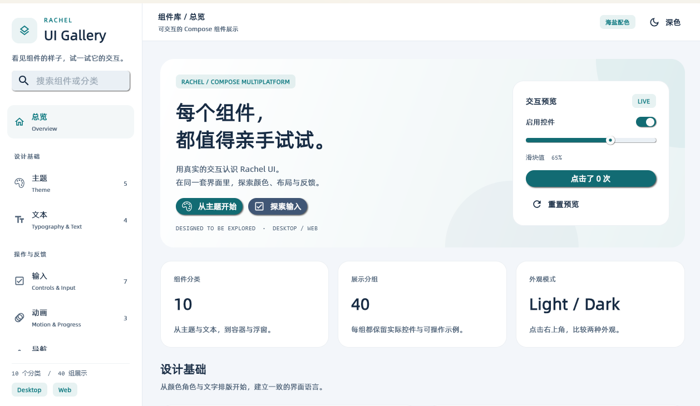    |    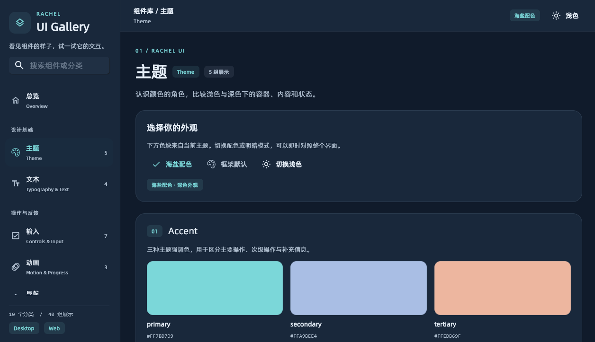    |
|                        Text                        |                      RichText                      |
|   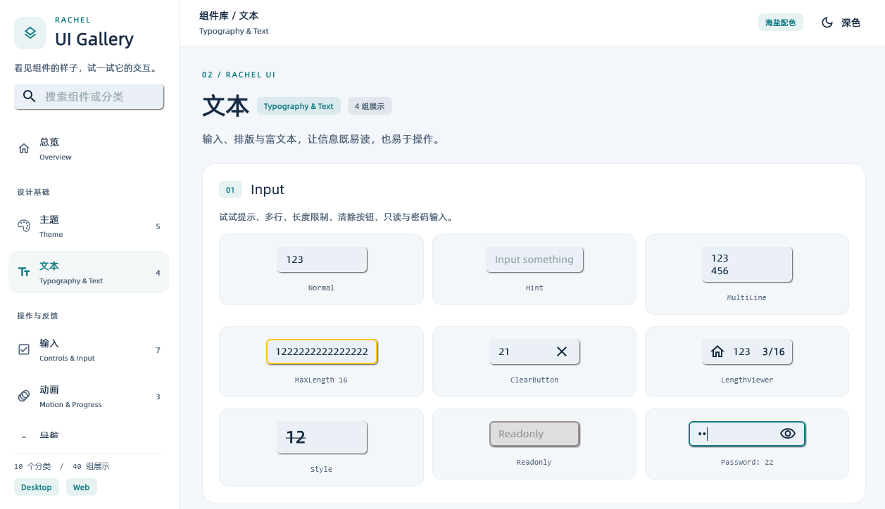    |   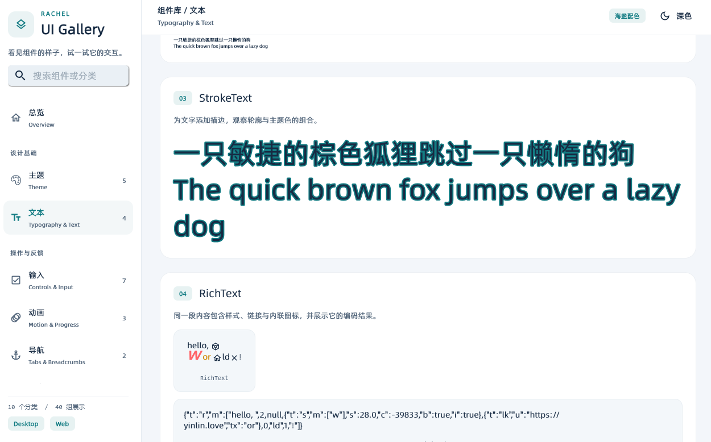    |
|                       Input                       |                       Animation                        |
|   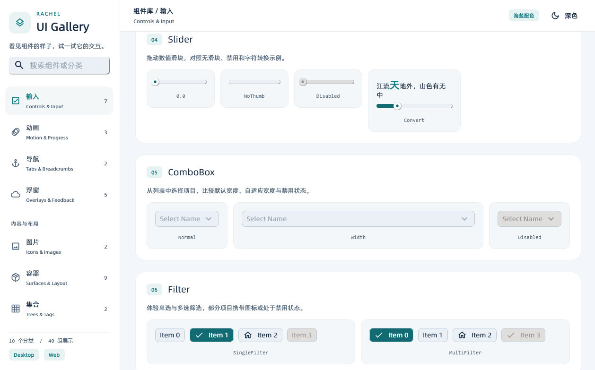   |   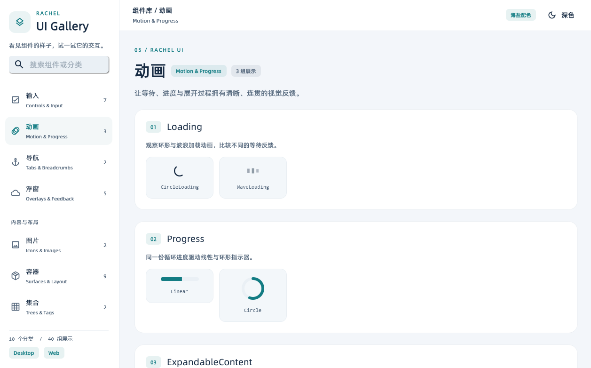   |
|                     Navigation                      |                   Dialog                   |
| 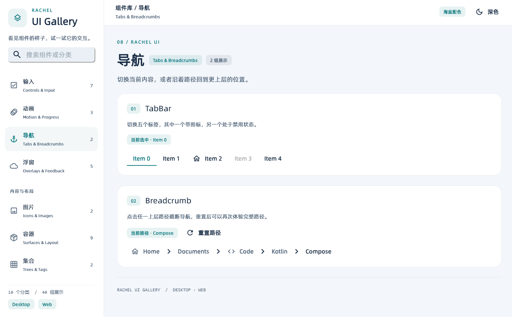 | 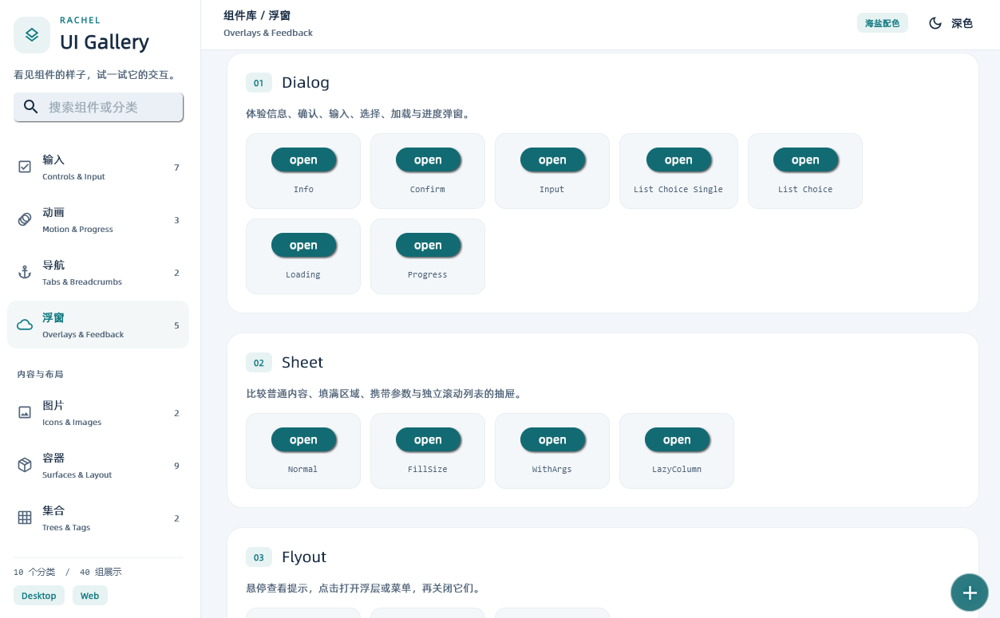 |
|                     Image                     |                      Container                      |
| 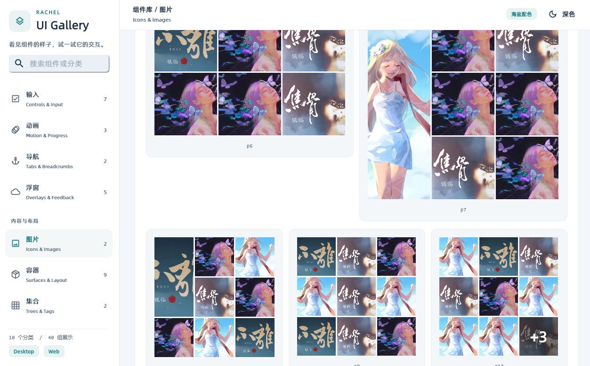 |  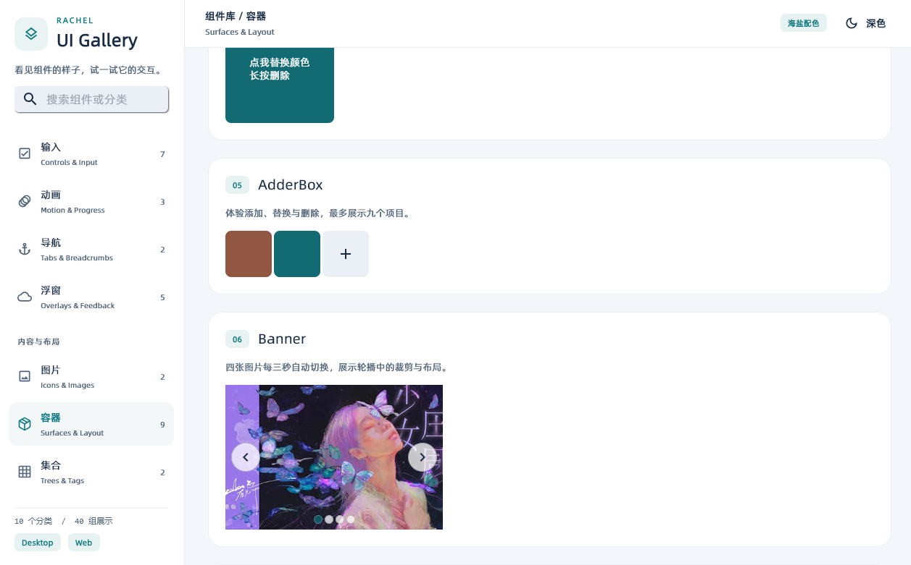  |
|                     Collection                      |                     Calendar                     |
| 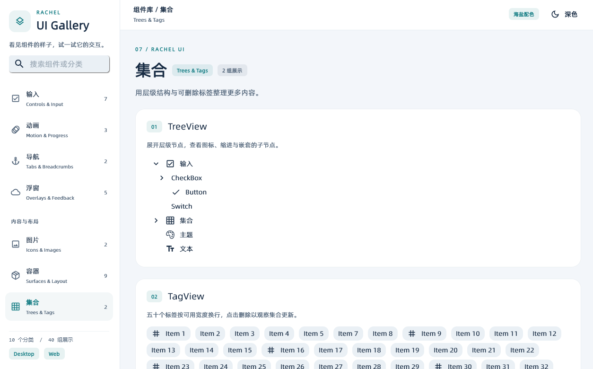  | 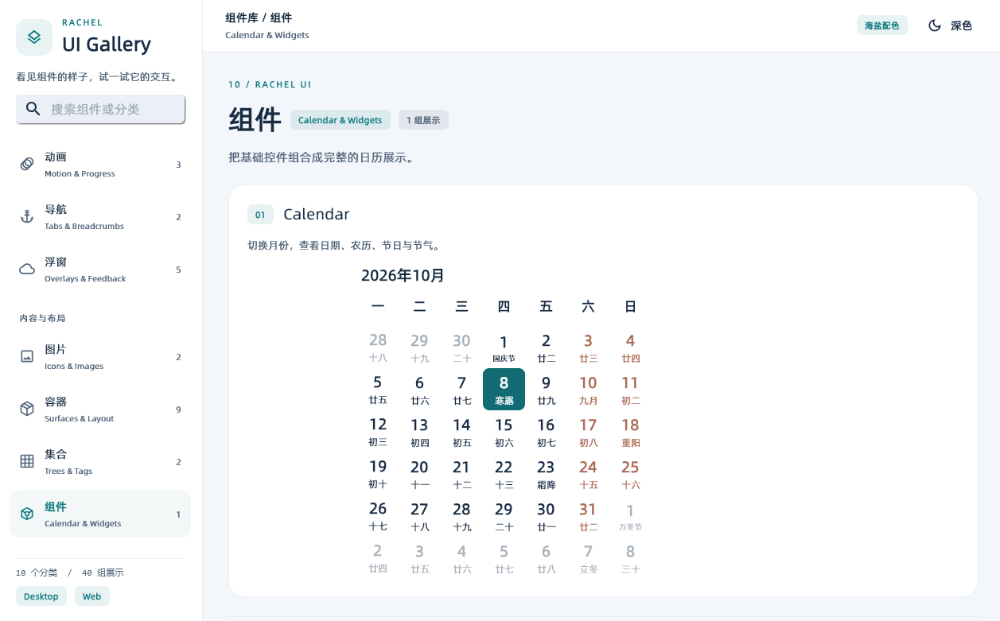 |


# 全平台模块支持

下表按目录层级列出 `ylcs-module` 中的全部模块。`✅` 表示支持该 target，`➖` 表示未启用该 target，或该平台仅有空实现、占位实现。模块内部分功能的平台差异见用途栏。构建工具在 Gradle 中运行，不具有应用运行 target。支持 target 不等同于所有 API 均已通过该平台的运行验证。

| 模块层级（相对 `ylcs-module/`） | Android | iOS | Desktop JVM | WasmJS | JS | Native Windows | Native Linux | Native macOS | 模块用途 |
| --- | :---: | :---: | :---: | :---: | :---: | :---: | :---: | :---: | --- |
| [`├─ build-tool`](ylcs-module/build-tool) | ➖ | ➖ | ➖ | ➖ | ➖ | ➖ | ➖ | ➖ | 聚合各平台库测试任务；无应用运行 target |
| [`├─ dokka`](ylcs-module/dokka) | ➖ | ➖ | ➖ | ➖ | ➖ | ➖ | ➖ | ➖ | 聚合模块 API 并生成 Dokka 站点；无应用运行 target |
| [`├─ core`](ylcs-module/core) | ✅ | ✅ | ✅ | ✅ | ✅ | ✅ | ✅ | ✅ | 平台识别、协程、序列化、集合、编码与字节操作 |
| **`├─ foundation/`** | ➖ | ➖ | ➖ | ➖ | ➖ | ➖ | ➖ | ➖ | 模块分组 |
| [`│  ├─ context`](ylcs-module/foundation/context) | ✅ | ✅ | ✅ | ✅ | ✅ | ✅ | ✅ | ✅ | 平台基础上下文与宿主能力提供者 |
| [`│  ├─ filesystem`](ylcs-module/foundation/filesystem) | ✅ | ✅ | ✅ | ✅ | ✅ | ✅ | ✅ | ✅ | 文件、流、平台目录与隐式文件 URI |
| [`│  ├─ network`](ylcs-module/foundation/network) | ✅ | ✅ | ✅ | ✅ | ✅ | ✅ | ✅ | ✅ | Ktor HTTP、下载与文本 WebSocket |
| [`│  ├─ startup`](ylcs-module/foundation/startup) | ✅ | ✅ | ✅ | ✅ | ✅ | ✅ | ✅ | ✅ | 启动服务依赖图、初始化与销毁 |
| [`│  ├─ compression`](ylcs-module/foundation/compression) | ✅ | ✅ | ✅ | ✅ | ✅ | ✅ | ✅ | ✅ | RLE、LZ4、Snappy、Deflate、Zlib、Gzip 编解码 |
| [`│  ├─ cryptography`](ylcs-module/foundation/cryptography) | ✅ | ✅ | ✅ | ✅ | ✅ | ✅ | ✅ | ✅ | 摘要、对称加密与相关编码工具 |
| [`│  ├─ fts`](ylcs-module/foundation/fts) | ✅ | ✅ | ✅ | ✅ | ✅ | ✅ | ✅ | ✅ | 多字段全文、前缀、整词与模糊检索 |
| **`│  ├─ parser/`** | ➖ | ➖ | ➖ | ➖ | ➖ | ➖ | ➖ | ➖ | 模块分组 |
| [`│  │  ├─ arguments`](ylcs-module/foundation/parser/arguments) | ✅ | ✅ | ✅ | ✅ | ✅ | ✅ | ✅ | ✅ | 命令行参数解析与类型化读取 |
| [`│  │  ├─ lrc`](ylcs-module/foundation/parser/lrc) | ✅ | ✅ | ✅ | ✅ | ✅ | ✅ | ✅ | ✅ | LRC 歌词、时间戳与元数据读写 |
| [`│  │  ├─ markdown`](ylcs-module/foundation/parser/markdown) | ✅ | ✅ | ✅ | ✅ | ✅ | ✅ | ✅ | ✅ | Markdown 语法树、DSL、解析与写入 |
| [`│  │  ├─ toml`](ylcs-module/foundation/parser/toml) | ✅ | ✅ | ✅ | ✅ | ✅ | ✅ | ✅ | ✅ | TOML 文档模型、DSL、解析与写入 |
| [`│  │  ├─ yaml`](ylcs-module/foundation/parser/yaml) | ✅ | ✅ | ✅ | ✅ | ✅ | ✅ | ✅ | ✅ | YAML 文档模型、DSL、解析与写入 |
| **`├─ compose/`** | ➖ | ➖ | ➖ | ➖ | ➖ | ➖ | ➖ | ➖ | 模块分组 |
| [`│  ├─ core`](ylcs-module/compose/core) | ✅ | ✅ | ✅ | ✅ | ✅ | ✅ | ✅ | ✅ | Compose 状态扩展、图形辅助与生命周期信号 |
| [`│  ├─ theme`](ylcs-module/compose/theme) | ✅ | ✅ | ✅ | ✅ | ✅ | ✅ | ✅ | ✅ | 主题、排版、尺寸、安全区与设备布局分类 |
| [`│  ├─ ui`](ylcs-module/compose/ui) | ✅ | ✅ | ✅ | ✅ | ✅ | ✅ | ✅ | ✅ | 基础布局、文本、输入、图像、动画与浮层 |
| [`│  ├─ icons`](ylcs-module/compose/icons) | ✅ | ✅ | ✅ | ✅ | ✅ | ✅ | ✅ | ✅ | Compose 图标资源 |
| [`│  ├─ platform-view`](ylcs-module/compose/platform-view) | ✅ | ✅ | ✅ | ✅ | ✅ | ✅ | ✅ | ✅ | Android View、Swing、UIKit、DOM 宿主；Native 仅公共状态层 |
| [`│  ├─ screen`](ylcs-module/compose/screen) | ✅ | ✅ | ✅ | ✅ | ✅ | ✅ | ✅ | ✅ | Navigation 3 页面导航与 ViewModel 生命周期 |
| [`│  ├─ cache`](ylcs-module/compose/cache) | ✅ | ✅ | ✅ | ✅ | ✅ | ✅ | ✅ | ✅ | 内存状态缓存与持久缓存抽象 |
| [`│  ├─ app`](ylcs-module/compose/app) | ✅ | ✅ | ✅ | ✅ | ✅ | ✅ | ✅ | ✅ | 跨平台应用入口、主题与窗口生命周期 |
| **`│  ├─ game/`** | ➖ | ➖ | ➖ | ➖ | ➖ | ➖ | ➖ | ➖ | 模块分组 |
| [`│  │  ├─ core`](ylcs-module/compose/game/core) | ✅ | ✅ | ✅ | ✅ | ✅ | ✅ | ✅ | ✅ | Compose 游戏引擎、实体、视口、事件与插件 |
| **`│  ├─ startup/`** | ➖ | ➖ | ➖ | ➖ | ➖ | ➖ | ➖ | ➖ | 模块分组 |
| [`│  │  ├─ config`](ylcs-module/compose/startup/config) | ✅ | ✅ | ✅ | ✅ | ✅ | ➖ | ➖ | ➖ | 基于 KV 的可观察持久配置 |
| [`│  │  ├─ exception`](ylcs-module/compose/startup/exception) | ✅ | ✅ | ✅ | ✅ | ✅ | ✅ | ✅ | ✅ | 未处理异常收集与记录服务 |
| [`│  │  ├─ mmkv-kmp`](ylcs-module/compose/startup/mmkv-kmp) | ✅ | ✅ | ✅ | ✅ | ✅ | ➖ | ➖ | ➖ | 平台键值存储；移动端/桌面 MMKV 与 Web 存储适配 |
| [`│  │  ├─ picker`](ylcs-module/compose/startup/picker) | ✅ | ✅ | ✅ | ✅ | ✅ | ➖ | ➖ | ➖ | 文件、目录等平台选择器 |
| **`│  ├─ components/`** | ➖ | ➖ | ➖ | ➖ | ➖ | ➖ | ➖ | ➖ | 模块分组 |
| [`│  │  ├─ image`](ylcs-module/compose/components/image) | ✅ | ✅ | ✅ | ✅ | ✅ | ✅ | ✅ | ✅ | 异步图片、动图、缩放、缓存与裁剪选区 |
| [`│  │  ├─ blur`](ylcs-module/compose/components/blur) | ✅ | ✅ | ✅ | ✅ | ✅ | ✅ | ✅ | ✅ | 模糊与遮罩效果 |
| [`│  │  ├─ calendar`](ylcs-module/compose/components/calendar) | ✅ | ✅ | ✅ | ✅ | ✅ | ✅ | ✅ | ✅ | 日历、农历与日期选择状态 |
| [`│  │  ├─ data-table`](ylcs-module/compose/components/data-table) | ✅ | ✅ | ✅ | ✅ | ✅ | ✅ | ✅ | ✅ | 数据表格、排序、编辑与选择 |
| [`│  │  ├─ drag-drop`](ylcs-module/compose/components/drag-drop) | ✅ | ➖ | ✅ | ✅ | ✅ | ✅ | ✅ | ✅ | 文本与文件拖放；iOS 当前为空实现 |
| [`│  │  ├─ hexview`](ylcs-module/compose/components/hexview) | ✅ | ✅ | ✅ | ✅ | ✅ | ✅ | ✅ | ✅ | 十六进制数据查看 |
| [`│  │  ├─ log-output`](ylcs-module/compose/components/log-output) | ✅ | ✅ | ✅ | ✅ | ✅ | ✅ | ✅ | ✅ | 日志输出与查看组件 |
| [`│  │  ├─ lottie`](ylcs-module/compose/components/lottie) | ✅ | ✅ | ✅ | ✅ | ✅ | ✅ | ✅ | ✅ | Lottie 动画渲染 |
| [`│  │  ├─ media`](ylcs-module/compose/components/media) | ✅ | ✅ | ✅ | ✅ | ✅ | ➖ | ➖ | ➖ | 音频、音乐与视频；JVM Linux/macOS 视频后端为空实现 |
| [`│  │  ├─ pagination-layout`](ylcs-module/compose/components/pagination-layout) | ✅ | ✅ | ✅ | ✅ | ✅ | ✅ | ✅ | ✅ | 分页数据状态与加载布局 |
| [`│  │  ├─ qrcode`](ylcs-module/compose/components/qrcode) | ✅ | ✅ | ✅ | ✅ | ✅ | ✅ | ✅ | ✅ | 全 target 二维码生成；扫码仅 Android/iOS 实现 |
| [`│  │  ├─ reordering`](ylcs-module/compose/components/reordering) | ✅ | ✅ | ✅ | ✅ | ✅ | ✅ | ✅ | ✅ | 拖动列表重排 |
| [`│  │  ├─ rich-text`](ylcs-module/compose/components/rich-text) | ✅ | ✅ | ✅ | ✅ | ✅ | ✅ | ✅ | ✅ | 富文本解析、节点与渲染 |
| [`│  │  ├─ webview`](ylcs-module/compose/components/webview) | ✅ | ✅ | ➖ | ✅ | ✅ | ➖ | ➖ | ➖ | Android/iOS/Web 网页视图；JVM 为占位实现 |
| **`├─ cs/`** | ➖ | ➖ | ➖ | ➖ | ➖ | ➖ | ➖ | ➖ | 模块分组 |
| [`│  ├─ core`](ylcs-module/cs/core) | ✅ | ✅ | ✅ | ✅ | ✅ | ✅ | ✅ | ✅ | 共享 API、资源树、文件参数与 Socket 契约 |
| [`│  ├─ client-engine`](ylcs-module/cs/client-engine) | ✅ | ✅ | ✅ | ✅ | ✅ | ✅ | ✅ | ✅ | 类型化 POST、multipart 请求与 Socket 客户端 |
| [`│  ├─ server-engine`](ylcs-module/cs/server-engine) | ➖ | ➖ | ➖ | ➖ | ➖ | ✅ | ✅ | ✅ | Ktor CIO 原生服务端、路由、上传与插件 |
| [`│  ├─ server-service-mysql`](ylcs-module/cs/server-service-mysql) | ➖ | ➖ | ➖ | ➖ | ➖ | ✅ | ✅ | ✅ | SQLx4k MySQL 连接池、查询与事务 |
| [`│  ├─ server-service-redis`](ylcs-module/cs/server-service-redis) | ➖ | ➖ | ➖ | ➖ | ➖ | ✅ | ✅ | ✅ | ReThis Redis 连接池与命令封装 |
| **`├─ native/`** | ➖ | ➖ | ➖ | ➖ | ➖ | ➖ | ➖ | ➖ | 模块分组 |
| **`│  ├─ win32/`** | ➖ | ➖ | ➖ | ➖ | ➖ | ➖ | ➖ | ➖ | 模块分组 |
| [`│  │  ├─ core`](ylcs-module/native/win32/core) | ➖ | ➖ | ➖ | ➖ | ➖ | ✅ | ➖ | ➖ | Kotlin/Native Win32 基础封装 |
| **`├─ platform/`** | ➖ | ➖ | ➖ | ➖ | ➖ | ➖ | ➖ | ➖ | 模块分组 |
| [`│  ├─ native-lib-loader`](ylcs-module/platform/native-lib-loader) | ✅ | ✅ | ✅ | ➖ | ➖ | ✅ | ✅ | ✅ | 动态库装载；Web 接口为空操作 |
| **`│  ├─ ffi/`** | ➖ | ➖ | ➖ | ➖ | ➖ | ➖ | ➖ | ➖ | 模块分组 |
| [`│  │  ├─ core`](ylcs-module/platform/ffi/core) | ➖ | ➖ | ✅ | ➖ | ➖ | ➖ | ➖ | ➖ | JDK Foreign Function & Memory API 基础封装 |
| [`│  │  ├─ posix`](ylcs-module/platform/ffi/posix) | ➖ | ➖ | ✅ | ➖ | ➖ | ➖ | ➖ | ➖ | JVM 调用 POSIX libc；仅适用于相应操作系统 |
| [`│  │  ├─ win32`](ylcs-module/platform/ffi/win32) | ➖ | ➖ | ✅ | ➖ | ➖ | ➖ | ➖ | ➖ | JVM 调用 Win32；仅适用于 Windows |
| **`│  ├─ os/`** | ➖ | ➖ | ➖ | ➖ | ➖ | ➖ | ➖ | ➖ | 模块分组 |
| [`│  │  ├─ single-instance`](ylcs-module/platform/os/single-instance) | ➖ | ➖ | ✅ | ➖ | ➖ | ➖ | ➖ | ➖ | JVM 桌面应用的操作系统单实例锁 |
| [`│  │  ├─ window`](ylcs-module/platform/os/window) | ➖ | ➖ | ✅ | ➖ | ➖ | ➖ | ➖ | ➖ | JVM 原生窗口鼠标穿透；Linux 当前为空实现 |

平台声明和默认开关以各模块 `build.gradle.kts` 及 `build-logic/public-plugin` 模板为准。WasmJS 指浏览器 WebAssembly target；桌面 Native 分别为 `mingwX64("windows")`、`linuxX64("linux")`、`macosArm64("macos")`。iOS 包含 `iosArm64`，并在 Apple Silicon macOS 宿主上配置 `iosSimulatorArm64`；Android 当前 minSdk 为 28，打包 ABI 为 `arm64-v8a`。Compose Native 消费端需要匹配版本的 [Native Compose 桥插件](native-compose/README.md)；JVM FFI 模块不代表支持 Kotlin/Native。权限、系统服务及原生依赖要求仍以具体 API 为准。

# 案例：银临茶舍跨平台 App

> [!IMPORTANT]
>
>  基于`Rachel`框架开发的集资讯、听歌、美图、论坛、社交于一体的小银子聚集地应用程序
> 
>  银临茶舍水群：`828049503`
> 
>  银临茶舍官网：[https://yinlin.love](https://yinlin.love)

基于本案例，你可以学习到除了 `Rachel` 框架、`Rachel` 界面库外，更多 `KMP` 在架构设计、跨平台兼容等方面上有趣的实现，包括但不限于如下：

- 多模块、多APP的数据共享、结构共享
- 基于 Screen 的单一数据源的开发模式
- 多窗口、悬浮窗口的黑盒接口
- 音视频、多媒体、WebView 的跨平台实现
- 基于 Canvas 自绘的简单游戏引擎和一款音游的设计实现

### 功能预览


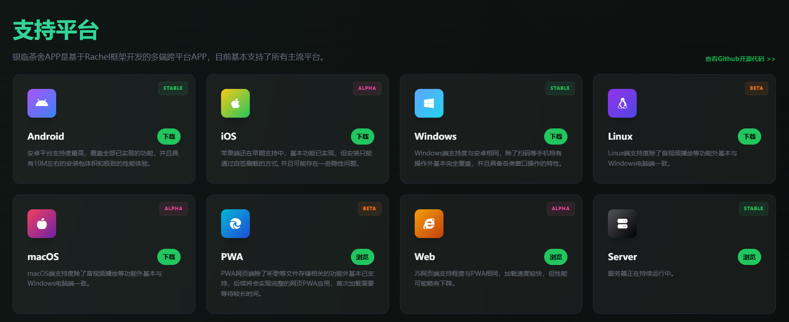


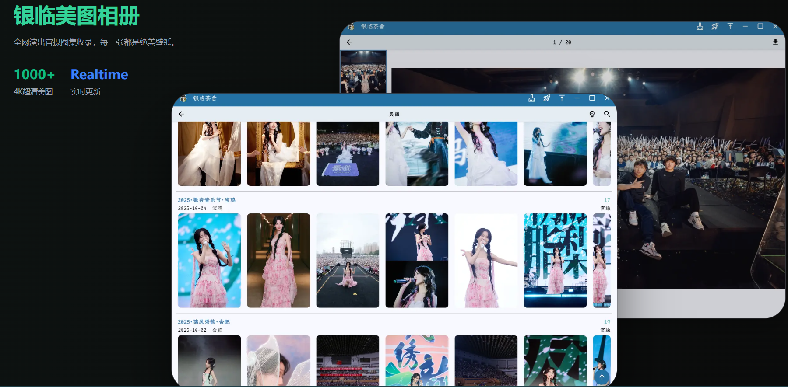


### 宣发视频

https://private-user-images.githubusercontent.com/76944654/586743677-ce62598a-7516-4ca9-bc2c-5b74d3f0907b.mp4?jwt=eyJ0eXAiOiJKV1QiLCJhbGciOiJIUzI1NiJ9.eyJpc3MiOiJnaXRodWIuY29tIiwiYXVkIjoicmF3LmdpdGh1YnVzZXJjb250ZW50LmNvbSIsImtleSI6ImtleTUiLCJleHAiOjE3Nzc3MjYzMzcsIm5iZiI6MTc3NzcyNjAzNywicGF0aCI6Ii83Njk0NDY1NC81ODY3NDM2NzctY2U2MjU5OGEtNzUxNi00Y2E5LWJjMmMtNWI3NGQzZjA5MDdiLm1wND9YLUFtei1BbGdvcml0aG09QVdTNC1ITUFDLVNIQTI1NiZYLUFtei1DcmVkZW50aWFsPUFLSUFWQ09EWUxTQTUzUFFLNFpBJTJGMjAyNjA1MDIlMkZ1cy1lYXN0LTElMkZzMyUyRmF3czRfcmVxdWVzdCZYLUFtei1EYXRlPTIwMjYwNTAyVDEyNDcxN1omWC1BbXotRXhwaXJlcz0zMDAmWC1BbXotU2lnbmF0dXJlPTRmMTE4ODg4OGFlMzQzYTIwNWJkYTg1NDNiYjA2NTZmYzVkMjJmMTg3NTZlNTRiMDMyMDkwYTZlMGY3NzEzMWQmWC1BbXotU2lnbmVkSGVhZGVycz1ob3N0JnJlc3BvbnNlLWNvbnRlbnQtdHlwZT12aWRlbyUyRm1wNCJ9.5JTH4EpoqLDxRf3v-pLe-ae4Oex3jkzVXeSvhUO2Y_g

## 贡献者

[](https://github.com/rachel-ylcs/ylcs-kmp/graphs/contributors)

## 许可

`银临茶舍` 是在 MIT 许可下许可的开源软件，查看[LICENSE](LICENSE)获取更多信息。

## 致谢 & 依赖

按首字母排序。

|   Type   |     Author      |                                                                                Name                                                                                |
|:--------:|:---------------:|:------------------------------------------------------------------------------------------------------------------------------------------------------------------:|
| Library  |     Google      |                                                            [media3](https://github.com/androidx/media)                                                             |
| Library  |    Jetbrains    | [kotlin](https://github.com/JetBrains/kotlin), [compose-multiplatform](https://github.com/JetBrains/compose-multiplatform), [ktor](https://github.com/ktorio/ktor) |
| Library  |     mlabbe      |                                                   [nativefiledialog](https://github.com/mlabbe/nativefiledialog)                                                   |
| Library  |      smyrgeorge      |                                                             [sqlx4k](https://github.com/smyrgeorge/sqlx4k)                                                              |
| Library  |     Tencent     |                                        [MMKV](https://github.com/Tencent/MMKV), [libpag](https://github.com/Tencent/libpag)                                        |
| Library  |     vendelieu     |                                        [re.this](https://github.com/vendelieu/re.this)                                        |
