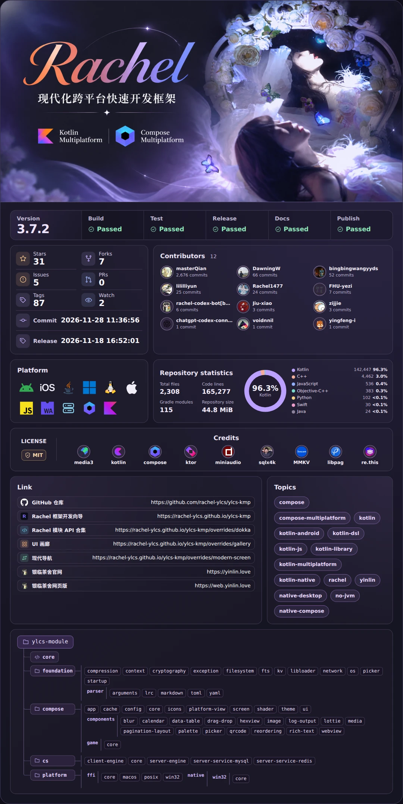
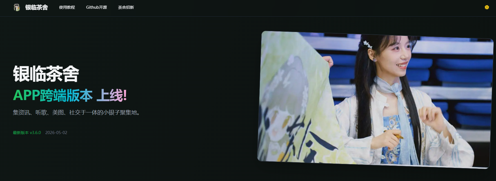
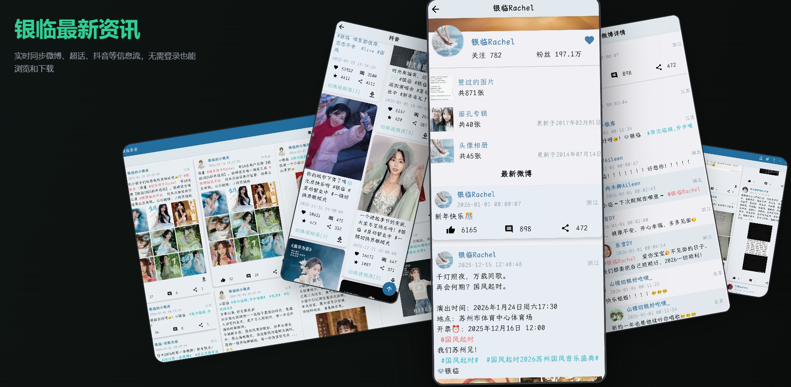
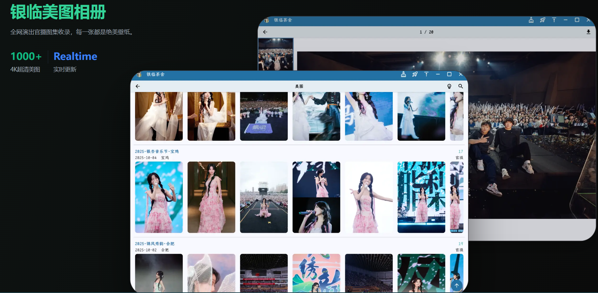

## 语言 (Language) :
### **中文** | [English](README_en.md)

# Rachel 快速开发框架

> [!NOTE]
> `Rachel`是基于`Kotlin Multiplatform`与`Compose Multiplatform`集成逻辑、服务、UI的跨平台快速开发框架。
>
> 由银临茶舍项目组完成开发。

# 特性

> [!Tip]
> - **跨平台**：基于`KMP` / `CMP`，支持全平台客户端与服务端，具有多端一致性。
> - **原生性能**：生成平台原生二进制文件，无桥接或附加库。
> - **单一语言**：仅需掌握`kotlin`语言即可完成大多数任务需求与开发。
> - **快速**：三分钟便能上手构建自己的跨平台应用程序。
> - **简洁**：大量类型安全与结构化的框架DSL，无需编写过多样板代码。
> - **模块化**：全框架模块化，模块间依赖清晰，应用程序按需引入模块。
> - **高协作**：框架支持前后端协作开发，共享数据组织结构。

# 文档

> [!IMPORTANT]
> ### 1. [Rachel框架开发向导](https://rachel-ylcs.github.io/ylcs-kmp)
> ### 2. [Rachel模块API合集](https://rachel-ylcs.github.io/ylcs-kmp/overrides/dokka)

# Rachel Compose UI 界面库

界面库涵盖大量UI组件，支持暗色模式，界面库独立，支持 `native compose` , 无 `material` 依赖。

> [!IMPORTANT]
> ### 1. [UI在线画廊](https://rachel-ylcs.github.io/ylcs-kmp/overrides/gallery)
> ### 2. [现代导航预览](https://rachel-ylcs.github.io/ylcs-kmp/overrides/modern-screen)

# 案例：银临茶舍跨平台 App

> [!IMPORTANT]
>
>  基于`Rachel`框架开发的集资讯、听歌、美图、论坛、社交于一体的小银子聚集地应用程序
> 
>  银临茶舍水群：`828049503`
> 
>  银临茶舍官网：[https://yinlin.love](https://yinlin.love)

### 功能预览

### 宣发视频

https://private-user-images.githubusercontent.com/76944654/719117260-84a79114-6540-4cd4-a0b5-892960823d88.mp4?jwt=eyJ0eXAiOiJKV1QiLCJhbGciOiJIUzI1NiJ9.eyJpc3MiOiJnaXRodWIuY29tIiwiYXVkIjoicmF3LmdpdGh1YnVzZXJjb250ZW50LmNvbSIsImtleSI6ImtleTUiLCJleHAiOjE3OTU2MzE1OTYsIm5iZiI6MTc5NTYzMTI5NiwicGF0aCI6Ii83Njk0NDY1NC83MTkxMTcyNjAtODRhNzkxMTQtNjU0MC00Y2Q0LWEwYjUtODkyOTYwODIzZDg4Lm1wND9YLUFtei1BbGdvcml0aG09QVdTNC1ITUFDLVNIQTI1NiZYLUFtei1DcmVkZW50aWFsPUFLSUFWQ09EWUxTQTUzUFFLNFpBJTJGMjAyNjExMjUlMkZ1cy1lYXN0LTElMkZzMyUyRmF3czRfcmVxdWVzdCZYLUFtei1EYXRlPTIwMjYxMTI1VDE4MjgxNlomWC1BbXotRXhwaXJlcz0zMDAmWC1BbXotU2lnbmF0dXJlPWI4NDVhOWI3MTA4ZDAxNGE1YzZkNGM5NDMwMjk5NjVjMWE1YTBiMGNjMTkwNTM1OTg5ZDkxOGFmYjFiYTBlZjYmWC1BbXotU2lnbmVkSGVhZGVycz1ob3N0JnJlc3BvbnNlLWNvbnRlbnQtdHlwZT12aWRlbyUyRm1wNCJ9.i2kaEaj12Wt5qKM56Mm9YY3HcQVD7ZReQJhN8xOI260
