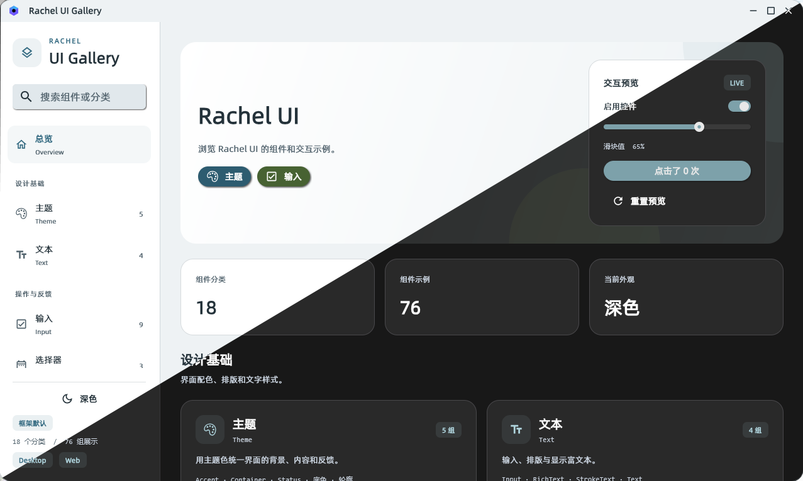
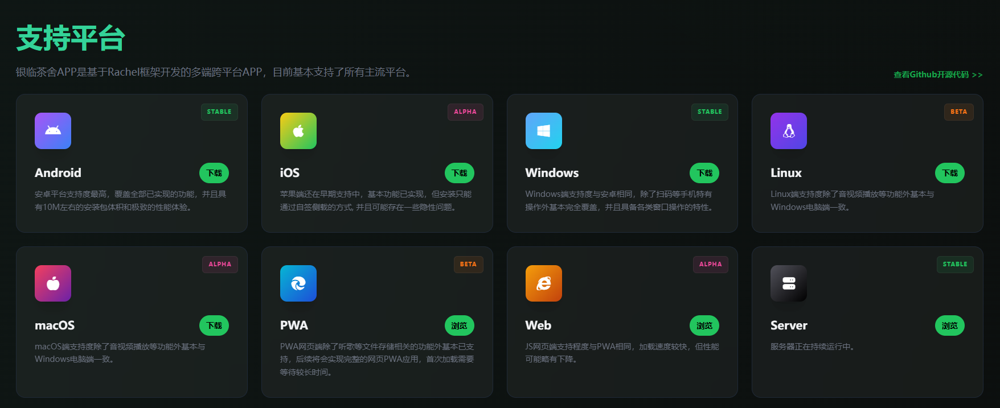
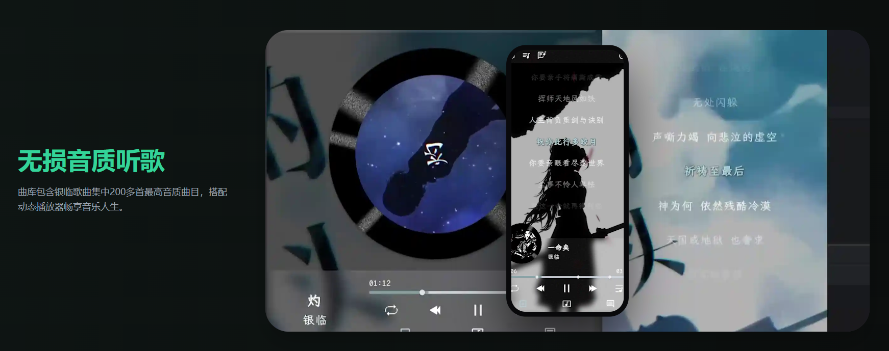
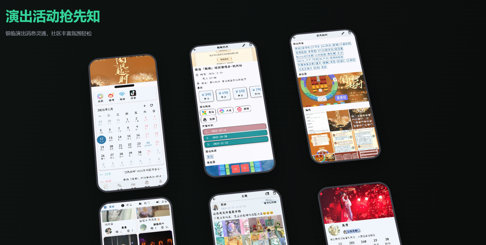
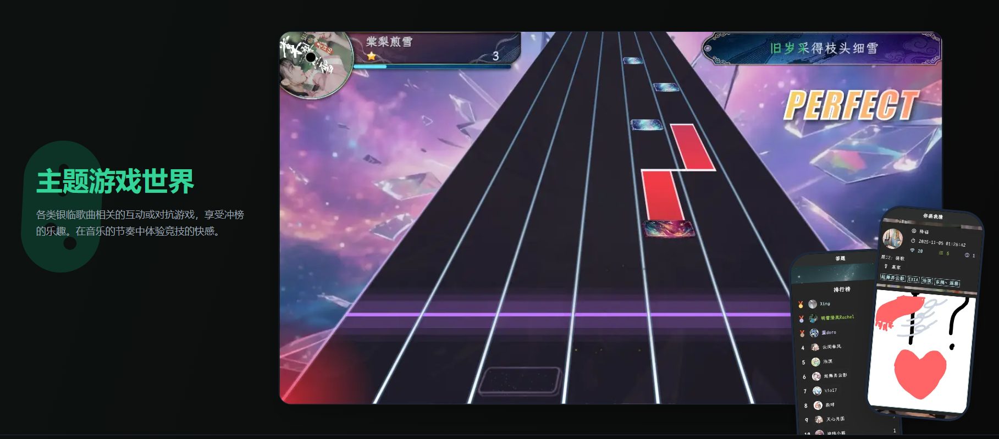

<div>
    <h5></h5>
    <div>
        
        
        
        
        
        
        
        
    </div>
    <h5></h5>
    <div>
        
        
        <br>
        
        
        
        
        
        
    </div>
    <h5></h5>
</div>

### 语言 (Language) :
**中文** | [English](README_en.md)

# Rachel快速开发框架

`Rachel`是基于`Kotlin Multiplatform`与`Compose Multiplatform`集成逻辑、服务、UI的跨平台快速开发框架，由银临茶舍项目组完成开发。

涵盖跨平台入口、共享UI、依赖服务启动、客户端和服务端交互引擎、自由屏幕导航、平台原生组件、自定义主题、响应式布局、MDI配置一致性、分页加载、服务端路由等领域。

### 我们支持原生 Compose 桌面程序 !!!

|Target|  VM  |  Native  |  Native Compose  |
|:---:|:---:|:---:|:---:|
|  Android  |✅|➖|✅|
|  iOS  |➖|✅|✅|
|  Windows  |✅|✅|✅|
|  Linux  |✅|✅|✅|
|  macOS  |✅|✅|✅|
|  Web  |✅|✅|✅|
|Server|✅|✅|➖|

- **VM**: `JVM` or `JavaScript`
- **Native**: `Kotlin Native` or `Web Assembly`
- **Native Compose**: **The bridge plugin makes native compose desktop possible!**

## 特性

- **跨平台**：基于`KMP` / `CMP`，支持全平台客户端与服务端，具有多端一致性。
- **原生性能**：生成平台原生二进制文件，无桥接或附加库。
- **单一语言**：仅需掌握`kotlin`语言即可完成大多数任务需求与开发。
- **快速**：三分钟便能上手构建自己的跨平台应用程序。
- **简洁**：大量类型安全与结构化的框架DSL，无需编写过多样板代码。
- **模块化**：全框架模块化，模块间依赖清晰，应用程序按需引入模块。
- **高协作**：框架支持前后端协作开发，共享数据组织结构。

# 文档

一个最简单的应用程序可以仅导入app模块（注意版本号）：

```kotlin
implementation("love.yinlin.compose:app:x.x.x")
```

|文档|链接|
|:---:|:---:|
| 入门指引 |  [Rachel框架开发向导](https://rachel-ylcs.github.io/ylcs-kmp)  |
|API|  [模块API合集](https://rachel-ylcs.github.io/ylcs-kmp/overrides/dokka)  |

# Rachel Compose UI 界面库

界面库涵盖大量UI组件，支持暗色模式，界面库独立，支持 `native compose` , 无 `material` 依赖。



|预览|链接|
|:---:|:---:|
|  UI 画廊  |  [Rachel UI Gallery](https://rachel-ylcs.github.io/ylcs-kmp/overrides/gallery)  |
|导航|  [Modern Navigation](https://rachel-ylcs.github.io/ylcs-kmp/overrides/modern-screen)  |

# 全平台模块支持

| 模块 | KMP | 模块 | KMP |
| :---: | :---: | :---: | :---: |
| [core](ylcs-module/core) | ✅ | [compose/game/core](ylcs-module/compose/game/core) | ✅ |
| [foundation/context](ylcs-module/foundation/context) | ✅ | [compose/components/blur](ylcs-module/compose/components/blur) | ✅ |
| [foundation/libloader](ylcs-module/foundation/libloader) | ✅ | [compose/components/calendar](ylcs-module/compose/components/calendar) | ✅ |
| [foundation/filesystem](ylcs-module/foundation/filesystem) | ✅ | [compose/components/data-table](ylcs-module/compose/components/data-table) | ✅ |
| [foundation/network](ylcs-module/foundation/network) | ✅ | [compose/components/drag-drop](ylcs-module/compose/components/drag-drop) | ✅ |
| [foundation/startup](ylcs-module/foundation/startup) | ✅ | [compose/components/hexview](ylcs-module/compose/components/hexview) | ✅ |
| [foundation/os](ylcs-module/foundation/os) | ✅ | [compose/components/image](ylcs-module/compose/components/image) | ✅ |
| [foundation/picker](ylcs-module/foundation/picker) | ✅ | [compose/components/log-output](ylcs-module/compose/components/log-output) | ✅ |
| [foundation/kv](ylcs-module/foundation/kv) | ✅ | [compose/components/lottie](ylcs-module/compose/components/lottie) | ✅ |
| [foundation/exception](ylcs-module/foundation/exception) | ✅ | [compose/components/media](ylcs-module/compose/components/media) | ✅ |
| [foundation/compression](ylcs-module/foundation/compression) | ✅ | [compose/components/pagination-layout](ylcs-module/compose/components/pagination-layout) | ✅ |
| [foundation/cryptography](ylcs-module/foundation/cryptography) | ✅ | [compose/components/palette](ylcs-module/compose/components/palette) | ✅ |
| [foundation/fts](ylcs-module/foundation/fts) | ✅ | [compose/components/picker](ylcs-module/compose/components/picker) | ✅ |
| [foundation/parser/arguments](ylcs-module/foundation/parser/arguments) | ✅ | [compose/components/qrcode](ylcs-module/compose/components/qrcode) | ✅ |
| [foundation/parser/lrc](ylcs-module/foundation/parser/lrc) | ✅ | [compose/components/reordering](ylcs-module/compose/components/reordering) | ✅ |
| [foundation/parser/markdown](ylcs-module/foundation/parser/markdown) | ✅ | [compose/components/rich-text](ylcs-module/compose/components/rich-text) | ✅ |
| [foundation/parser/toml](ylcs-module/foundation/parser/toml) | ✅ | [compose/components/webview](ylcs-module/compose/components/webview) | ✅ |
| [foundation/parser/yaml](ylcs-module/foundation/parser/yaml) | ✅ | [cs/core](ylcs-module/cs/core) | ✅ |
| [compose/core](ylcs-module/compose/core) | ✅ | [cs/client-engine](ylcs-module/cs/client-engine) | ✅ |
| [compose/theme](ylcs-module/compose/theme) | ✅ | [cs/server-engine](ylcs-module/cs/server-engine) | ➖ |
| [compose/ui](ylcs-module/compose/ui) | ✅ | [cs/server-service-mysql](ylcs-module/cs/server-service-mysql) | ➖ |
| [compose/icons](ylcs-module/compose/icons) | ✅ | [cs/server-service-redis](ylcs-module/cs/server-service-redis) | ➖ |
| [compose/platform-view](ylcs-module/compose/platform-view) | ✅ | [platform/ffi/core](ylcs-module/platform/ffi/core) | ➖ |
| [compose/screen](ylcs-module/compose/screen) | ✅ | [platform/ffi/posix](ylcs-module/platform/ffi/posix) | ➖ |
| [compose/cache](ylcs-module/compose/cache) | ✅ | [platform/ffi/win32](ylcs-module/platform/ffi/win32) | ➖ |
| [compose/app](ylcs-module/compose/app) | ✅ | [platform/native/win32/core](ylcs-module/platform/native/win32/core) | ➖ |
| [compose/config](ylcs-module/compose/config) | ✅ |  |  |

# 案例：银临茶舍跨平台 App

> [!IMPORTANT]
>
>  基于`Rachel`框架开发的集资讯、听歌、美图、论坛、社交于一体的小银子聚集地应用程序
> 
>  银临茶舍水群：`828049503`
> 
>  银临茶舍官网：[https://yinlin.love](https://yinlin.love)

基于本案例，你可以学习到除了 `Rachel` 框架、`Rachel` 界面库外，更多 `KMP` 在架构设计、跨平台兼容等方面上有趣的实现，包括但不限于如下：

- 多模块、多APP的数据共享、结构共享
- 基于 Screen 的单一数据源的开发模式
- 多窗口、悬浮窗口的黑盒接口
- 音视频、多媒体、WebView 的跨平台实现
- 基于 Canvas 自绘的简单游戏引擎和一款音游的设计实现

### 功能预览









### 宣发视频

https://private-user-images.githubusercontent.com/76944654/586743677-ce62598a-7516-4ca9-bc2c-5b74d3f0907b.mp4?jwt=eyJ0eXAiOiJKV1QiLCJhbGciOiJIUzI1NiJ9.eyJpc3MiOiJnaXRodWIuY29tIiwiYXVkIjoicmF3LmdpdGh1YnVzZXJjb250ZW50LmNvbSIsImtleSI6ImtleTUiLCJleHAiOjE3Nzc3MjYzMzcsIm5iZiI6MTc3NzcyNjAzNywicGF0aCI6Ii83Njk0NDY1NC81ODY3NDM2NzctY2U2MjU5OGEtNzUxNi00Y2E5LWJjMmMtNWI3NGQzZjA5MDdiLm1wND9YLUFtei1BbGdvcml0aG09QVdTNC1ITUFDLVNIQTI1NiZYLUFtei1DcmVkZW50aWFsPUFLSUFWQ09EWUxTQTUzUFFLNFpBJTJGMjAyNjA1MDIlMkZ1cy1lYXN0LTElMkZzMyUyRmF3czRfcmVxdWVzdCZYLUFtei1EYXRlPTIwMjYwNTAyVDEyNDcxN1omWC1BbXotRXhwaXJlcz0zMDAmWC1BbXotU2lnbmF0dXJlPTRmMTE4ODg4OGFlMzQzYTIwNWJkYTg1NDNiYjA2NTZmYzVkMjJmMTg3NTZlNTRiMDMyMDkwYTZlMGY3NzEzMWQmWC1BbXotU2lnbmVkSGVhZGVycz1ob3N0JnJlc3BvbnNlLWNvbnRlbnQtdHlwZT12aWRlbyUyRm1wNCJ9.5JTH4EpoqLDxRf3v-pLe-ae4Oex3jkzVXeSvhUO2Y_g

## 贡献者

[](https://github.com/rachel-ylcs/ylcs-kmp/graphs/contributors)

## 许可

`银临茶舍` 是在 MIT 许可下许可的开源软件，查看[LICENSE](LICENSE)获取更多信息。

## 致谢 & 依赖

按首字母排序。

|   Type   |     Author      |                                                                                Name                                                                                |
|:--------:|:---------------:|:------------------------------------------------------------------------------------------------------------------------------------------------------------------:|
| Library  |     Google      |                                                            [media3](https://github.com/androidx/media)                                                             |
| Library  |    Jetbrains    | [kotlin](https://github.com/JetBrains/kotlin), [compose-multiplatform](https://github.com/JetBrains/compose-multiplatform), [ktor](https://github.com/ktorio/ktor) |
| Library  |mackron|[miniaudio](https://github.com/mackron/miniaudio)|
| Library  |      smyrgeorge      |                                                             [sqlx4k](https://github.com/smyrgeorge/sqlx4k)                                                              |
| Library  |     Tencent     |                                        [MMKV](https://github.com/Tencent/MMKV), [libpag](https://github.com/Tencent/libpag)                                        |
| Library  |     vendelieu     |                                        [re.this](https://github.com/vendelieu/re.this)                                        |
