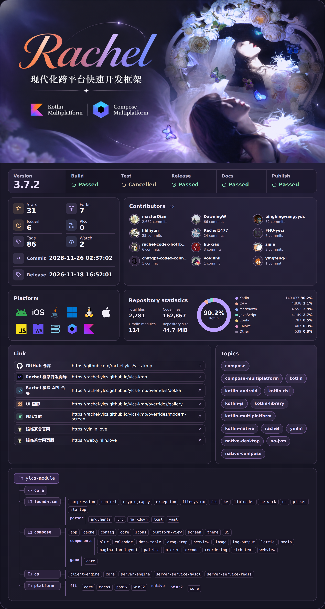
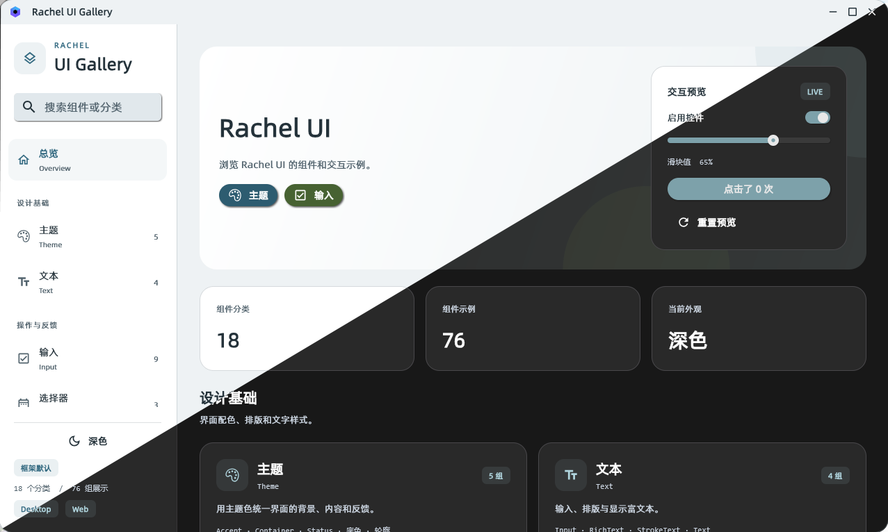
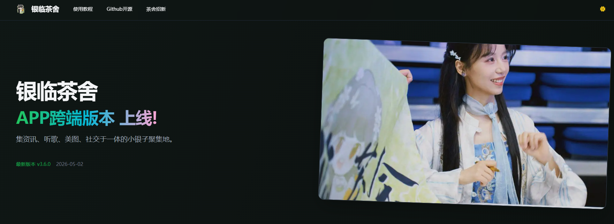
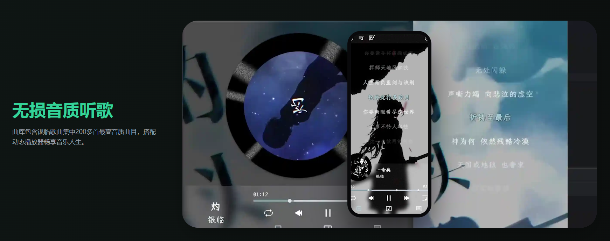
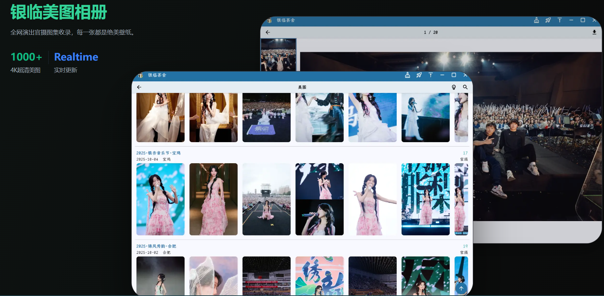
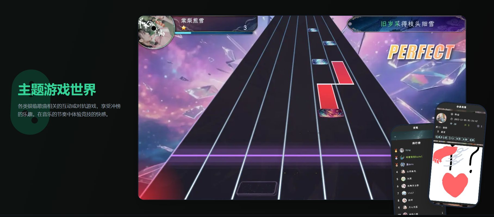

### 语言 (Language) :
[中文](README.md) | **English**

# Rachel Rapid Development Framework

`Rachel` is cross-platform rapid development framework that integrates logic, services, and UI based on `Kotlin Multiplatform` and `Compose Multiplatform`, and was developed by the 银临茶舍 project team.

## Feature

- **Cross-platform**: Based on `KMP` / `CMP`, it supports all platform clients and servers, with multi terminal consistency.
- **Native performance**: Generate platform native binary files without bridging or additional libraries.
- **Single language**: Mastering `kotlin` language is sufficient to complete most task requirements and development.
- **Quick**: You can start building your own cross-platform application in just three minutes.
- **Simple**: A large number of type safe and structured framework DSL, without the need to write too much template code.
- **Modularization**: The entire framework is modularized, with clear dependencies between modules, allowing applications to introduce modules as needed.
- **High Collaboration**: The framework supports front-end and back-end collaborative development, sharing data organizational structures.

# Document

|Documentation|Link|
|:---:|:---:|
| Getting Started |  [Rachel Framework Development Wizard](https://rachel-ylcs.github.io/ylcs-kmp)  |
|API|  [Module API](https://rachel-ylcs.github.io/ylcs-kmp/overrides/dokka)  |

# Rachel Compose UI Library

The UI library covers a large number of UI components, supports dark mode, is independent, supports `native compose`, and has no `material` dependencies.

|Preview|Link|
|:---:|:---:|
|  UI Gallery  |  [Rachel UI Gallery](https://rachel-ylcs.github.io/ylcs-kmp/overrides/gallery)  |
|Navigation|  [Modern Navigation](https://rachel-ylcs.github.io/ylcs-kmp/overrides/modern-screen)  |

# Sample: 银临茶舍 Cross-Platform App

> [!IMPORTANT]
>
>  A small silver gathering application developed based on the `Rachel` framework, integrating information, music listening, beautiful pictures, forums, and social networking.
>
>  银临茶舍 QQ Group：`828049503`
> 
>  银临茶舍 Official WebSite: [https://yinlin.love](https://yinlin.love)

### Feature Preview

### Video

https://private-user-images.githubusercontent.com/76944654/719117260-84a79114-6540-4cd4-a0b5-892960823d88.mp4?jwt=eyJ0eXAiOiJKV1QiLCJhbGciOiJIUzI1NiJ9.eyJpc3MiOiJnaXRodWIuY29tIiwiYXVkIjoicmF3LmdpdGh1YnVzZXJjb250ZW50LmNvbSIsImtleSI6ImtleTUiLCJleHAiOjE3OTU2MzE1OTYsIm5iZiI6MTc5NTYzMTI5NiwicGF0aCI6Ii83Njk0NDY1NC83MTkxMTcyNjAtODRhNzkxMTQtNjU0MC00Y2Q0LWEwYjUtODkyOTYwODIzZDg4Lm1wND9YLUFtei1BbGdvcml0aG09QVdTNC1ITUFDLVNIQTI1NiZYLUFtei1DcmVkZW50aWFsPUFLSUFWQ09EWUxTQTUzUFFLNFpBJTJGMjAyNjExMjUlMkZ1cy1lYXN0LTElMkZzMyUyRmF3czRfcmVxdWVzdCZYLUFtei1EYXRlPTIwMjYxMTI1VDE4MjgxNlomWC1BbXotRXhwaXJlcz0zMDAmWC1BbXotU2lnbmF0dXJlPWI4NDVhOWI3MTA4ZDAxNGE1YzZkNGM5NDMwMjk5NjVjMWE1YTBiMGNjMTkwNTM1OTg5ZDkxOGFmYjFiYTBlZjYmWC1BbXotU2lnbmVkSGVhZGVycz1ob3N0JnJlc3BvbnNlLWNvbnRlbnQtdHlwZT12aWRlbyUyRm1wNCJ9.i2kaEaj12Wt5qKM56Mm9YY3HcQVD7ZReQJhN8xOI260

## License

`银临茶舍` is an open-source software licensed under the MIT license, Please refer to [LICENSE](LICENSE) for more information.

## Credits & Dependencies

Sort by first letter.

|   Type   |     Author      |                                                                                Name                                                                                |
|:--------:|:---------------:|:------------------------------------------------------------------------------------------------------------------------------------------------------------------:|
| Library  |     Google      |                                                            [media3](https://github.com/androidx/media)                                                             |
| Library  |    Jetbrains    | [kotlin](https://github.com/JetBrains/kotlin), [compose-multiplatform](https://github.com/JetBrains/compose-multiplatform), [ktor](https://github.com/ktorio/ktor) |
| Library  |mackron|[miniaudio](https://github.com/mackron/miniaudio)|
| Library  |      smyrgeorge      |                                                             [sqlx4k](https://github.com/smyrgeorge/sqlx4k)                                                              |
| Library  |     Tencent     |                                        [MMKV](https://github.com/Tencent/MMKV), [libpag](https://github.com/Tencent/libpag)                                        |
| Library  |     vendelieu     |                                        [re.this](https://github.com/vendelieu/re.this)                                        |
