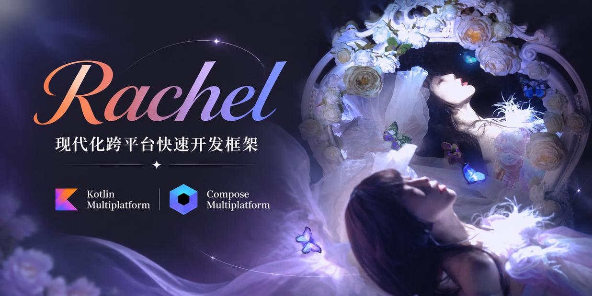
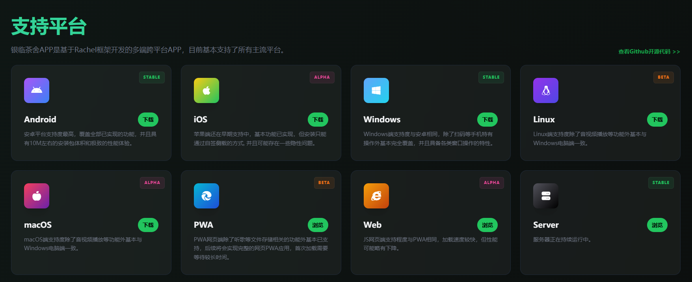
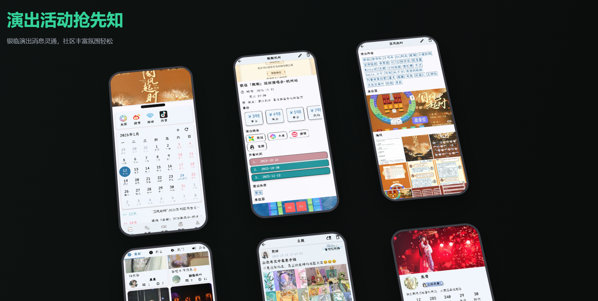

<div>
    <h5></h5>
    <div>
        
        
        
        
        
        
        
        
    </div>
    <h5></h5>
    <div>
        
        
        <br>
        
        
        
        
        
        
    </div>
    <h5></h5>
</div>

### 语言 (Language) :
[中文](README.md) | **English**

# Rachel Rapid Development Framework

`Rachel` is cross-platform rapid development framework that integrates logic, services, and UI based on `Kotlin Multiplatform` and `Compose Multiplatform`, and was developed by the 银临茶舍 project team.

Covering cross-platform entry, shared UI, dependent service startup, client and server interaction engines, free screen navigation, platform native components, custom themes, responsive layout, MDI configuration consistency, page loading, server routing, and other fields.

### We Support Native Compose Desktop Application !!!

|Target|  VM  |  Native  |  Native Compose  |
|:---:|:---:|:---:|:---:|
|  Android  |✅|➖|✅|
|  iOS  |➖|✅|✅|
|  Windows  |✅|✅|✅|
|  Linux  |✅|✅|✅|
|  macOS  |✅|✅|✅|
|  Web  |✅|✅|✅|
|Server|✅|✅|➖|

- **VM**: `JVM` or `JavaScript`
- **Native**: `Kotlin Native` or `Web Assembly`
- **Native Compose**: **The bridge plugin makes native compose desktop possible!**

## Feature

- **Cross-platform**: Based on `KMP` / `CMP`, it supports all platform clients and servers, with multi terminal consistency.
- **Native performance**: Generate platform native binary files without bridging or additional libraries.
- **Single language**: Mastering `kotlin` language is sufficient to complete most task requirements and development.
- **Quick**: You can start building your own cross-platform application in just three minutes.
- **Simple**: A large number of type safe and structured framework DSL, without the need to write too much template code.
- **Modularization**: The entire framework is modularized, with clear dependencies between modules, allowing applications to introduce modules as needed.
- **High Collaboration**: The framework supports front-end and back-end collaborative development, sharing data organizational structures.

# Document

The simplest application can only import the app module (note the version number):

```kotlin
implementation("love.yinlin.compose:app:x.x.x")
```

|Documentation|Link|
|:---:|:---:|
| Getting Started |  [Rachel Framework Development Wizard](https://rachel-ylcs.github.io/ylcs-kmp)  |
|API|  [Module API](https://rachel-ylcs.github.io/ylcs-kmp/overrides/dokka)  |

# Rachel Compose UI Library

The UI library covers a large number of UI components, supports dark mode, is independent, supports `native compose`, and has no `material` dependencies.


|Preview|Link|
|:---:|:---:|
|  UI Gallery  |  [Rachel UI Gallery](https://rachel-ylcs.github.io/ylcs-kmp/overrides/gallery)  |
|Navigation|  [Modern Navigation](https://rachel-ylcs.github.io/ylcs-kmp/overrides/modern-screen)  |

# Cross-Platform Module Support

| Module | KMP | Module | KMP |
| :---: | :---: | :---: | :---: |
| [core](ylcs-module/core) | ✅ | [compose/game/core](ylcs-module/compose/game/core) | ✅ |
| [foundation/context](ylcs-module/foundation/context) | ✅ | [compose/components/blur](ylcs-module/compose/components/blur) | ✅ |
| [foundation/libloader](ylcs-module/foundation/libloader) | ✅ | [compose/components/calendar](ylcs-module/compose/components/calendar) | ✅ |
| [foundation/filesystem](ylcs-module/foundation/filesystem) | ✅ | [compose/components/data-table](ylcs-module/compose/components/data-table) | ✅ |
| [foundation/network](ylcs-module/foundation/network) | ✅ | [compose/components/drag-drop](ylcs-module/compose/components/drag-drop) | ✅ |
| [foundation/startup](ylcs-module/foundation/startup) | ✅ | [compose/components/hexview](ylcs-module/compose/components/hexview) | ✅ |
| [foundation/os](ylcs-module/foundation/os) | ✅ | [compose/components/image](ylcs-module/compose/components/image) | ✅ |
| [foundation/picker](ylcs-module/foundation/picker) | ✅ | [compose/components/log-output](ylcs-module/compose/components/log-output) | ✅ |
| [foundation/kv](ylcs-module/foundation/kv) | ✅ | [compose/components/lottie](ylcs-module/compose/components/lottie) | ✅ |
| [foundation/exception](ylcs-module/foundation/exception) | ✅ | [compose/components/media](ylcs-module/compose/components/media) | ✅ |
| [foundation/compression](ylcs-module/foundation/compression) | ✅ | [compose/components/pagination-layout](ylcs-module/compose/components/pagination-layout) | ✅ |
| [foundation/cryptography](ylcs-module/foundation/cryptography) | ✅ | [compose/components/palette](ylcs-module/compose/components/palette) | ✅ |
| [foundation/fts](ylcs-module/foundation/fts) | ✅ | [compose/components/picker](ylcs-module/compose/components/picker) | ✅ |
| [foundation/parser/arguments](ylcs-module/foundation/parser/arguments) | ✅ | [compose/components/qrcode](ylcs-module/compose/components/qrcode) | ✅ |
| [foundation/parser/lrc](ylcs-module/foundation/parser/lrc) | ✅ | [compose/components/reordering](ylcs-module/compose/components/reordering) | ✅ |
| [foundation/parser/markdown](ylcs-module/foundation/parser/markdown) | ✅ | [compose/components/rich-text](ylcs-module/compose/components/rich-text) | ✅ |
| [foundation/parser/toml](ylcs-module/foundation/parser/toml) | ✅ | [compose/components/webview](ylcs-module/compose/components/webview) | ✅ |
| [foundation/parser/yaml](ylcs-module/foundation/parser/yaml) | ✅ | [cs/core](ylcs-module/cs/core) | ✅ |
| [compose/core](ylcs-module/compose/core) | ✅ | [cs/client-engine](ylcs-module/cs/client-engine) | ✅ |
| [compose/theme](ylcs-module/compose/theme) | ✅ | [cs/server-engine](ylcs-module/cs/server-engine) | ➖ |
| [compose/ui](ylcs-module/compose/ui) | ✅ | [cs/server-service-mysql](ylcs-module/cs/server-service-mysql) | ➖ |
| [compose/icons](ylcs-module/compose/icons) | ✅ | [cs/server-service-redis](ylcs-module/cs/server-service-redis) | ➖ |
| [compose/platform-view](ylcs-module/compose/platform-view) | ✅ | [platform/ffi/core](ylcs-module/platform/ffi/core) | ➖ |
| [compose/screen](ylcs-module/compose/screen) | ✅ | [platform/ffi/posix](ylcs-module/platform/ffi/posix) | ➖ |
| [compose/cache](ylcs-module/compose/cache) | ✅ | [platform/ffi/win32](ylcs-module/platform/ffi/win32) | ➖ |
| [compose/app](ylcs-module/compose/app) | ✅ | [platform/native/win32/core](ylcs-module/platform/native/win32/core) | ➖ |
| [compose/config](ylcs-module/compose/config) | ✅ |  |  |

# Sample: 银临茶舍 Cross-Platform App

> [!IMPORTANT]
>
>  A small silver gathering application developed based on the `Rachel` framework, integrating information, music listening, beautiful pictures, forums, and social networking.
>
>  银临茶舍 QQ Group：`828049503`
> 
>  银临茶舍 Official WebSite: [https://yinlin.love](https://yinlin.love)

Based on this case, you can learn that in addition to the `Rachel framework` and `Rachel interface library`,
there are more interesting implementations of `KMP` in terms of architecture design and cross-platform compatibility,
including but not limited to the following:

- Multi-module, Multi-APP data sharing and structure sharing
- A single source of truth for Screen-based development
- Black box interface for multi-window and floating windows
- Cross-platform implementation of audio and video, multimedia, and WebView
- A simple game engine based on canvas self drawing

### Feature Preview








### Video

https://private-user-images.githubusercontent.com/76944654/586743677-ce62598a-7516-4ca9-bc2c-5b74d3f0907b.mp4?jwt=eyJ0eXAiOiJKV1QiLCJhbGciOiJIUzI1NiJ9.eyJpc3MiOiJnaXRodWIuY29tIiwiYXVkIjoicmF3LmdpdGh1YnVzZXJjb250ZW50LmNvbSIsImtleSI6ImtleTUiLCJleHAiOjE3Nzc3MjYzMzcsIm5iZiI6MTc3NzcyNjAzNywicGF0aCI6Ii83Njk0NDY1NC81ODY3NDM2NzctY2U2MjU5OGEtNzUxNi00Y2E5LWJjMmMtNWI3NGQzZjA5MDdiLm1wND9YLUFtei1BbGdvcml0aG09QVdTNC1ITUFDLVNIQTI1NiZYLUFtei1DcmVkZW50aWFsPUFLSUFWQ09EWUxTQTUzUFFLNFpBJTJGMjAyNjA1MDIlMkZ1cy1lYXN0LTElMkZzMyUyRmF3czRfcmVxdWVzdCZYLUFtei1EYXRlPTIwMjYwNTAyVDEyNDcxN1omWC1BbXotRXhwaXJlcz0zMDAmWC1BbXotU2lnbmF0dXJlPTRmMTE4ODg4OGFlMzQzYTIwNWJkYTg1NDNiYjA2NTZmYzVkMjJmMTg3NTZlNTRiMDMyMDkwYTZlMGY3NzEzMWQmWC1BbXotU2lnbmVkSGVhZGVycz1ob3N0JnJlc3BvbnNlLWNvbnRlbnQtdHlwZT12aWRlbyUyRm1wNCJ9.5JTH4EpoqLDxRf3v-pLe-ae4Oex3jkzVXeSvhUO2Y_g

## Contributors

[](https://github.com/rachel-ylcs/ylcs-kmp/graphs/contributors)

## License

`银临茶舍` is an open-source software licensed under the MIT license, Please refer to [LICENSE](LICENSE) for more information.

## Credits & Dependencies

Sort by first letter.

|   Type   |     Author      |                                                                                Name                                                                                |
|:--------:|:---------------:|:------------------------------------------------------------------------------------------------------------------------------------------------------------------:|
| Library  |     Google      |                                                            [media3](https://github.com/androidx/media)                                                             |
| Library  |    Jetbrains    | [kotlin](https://github.com/JetBrains/kotlin), [compose-multiplatform](https://github.com/JetBrains/compose-multiplatform), [ktor](https://github.com/ktorio/ktor) |
| Library  |mackron|[miniaudio](https://github.com/mackron/miniaudio)|
| Library  |      smyrgeorge      |                                                             [sqlx4k](https://github.com/smyrgeorge/sqlx4k)                                                              |
| Library  |     Tencent     |                                        [MMKV](https://github.com/Tencent/MMKV), [libpag](https://github.com/Tencent/libpag)                                        |
| Library  |     vendelieu     |                                        [re.this](https://github.com/vendelieu/re.this)                                        |
