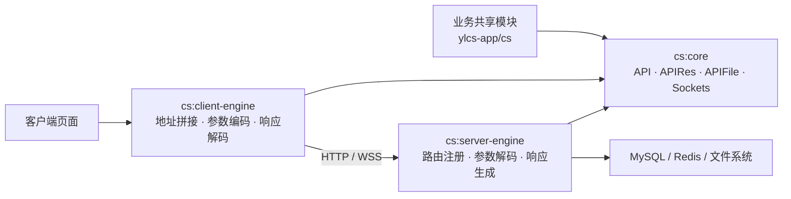

# 交互模型

<p class="rc-lead">Rachel 的客户端与服务端不是两套各自演进的接口，而是共享同一份契约：路由、参数位置、输出类型、资源路径与 Socket 入口都集中声明，两端只负责编码与执行。</p>

## 契约优先



| 层 | 模块 | 职责 |
| --- | --- | --- |
| 契约 | `cs:core` | API 声明、路由、资源、上传标记、Socket 入口 |
| 客户端 | `cs:client-engine` | 地址拼接、请求编码、状态码映射、上传与连接 |
| 服务端 | `cs:server-engine` | 路由注册、参数解码、响应协议、静态资源与插件 |
| 数据服务 | `cs:server-service-*` | MySQL 与 Redis 连接池 |
| 业务契约 | `ylcs-app/cs` | 真实接口、资源树与消息 DTO |

## 请求处理流程

```text title="POST 请求路径"
业务调用
  → 共享 API 类型约束输入/输出
  → 客户端引擎拼接 baseUrl 与路由
  → JSON 数组或 multipart 编码
  → 服务端按位置解码
  → APIScope 处理并生成响应
  → 客户端按声明读取输出
```

普通 POST 使用 JSON 数组，参数与输出按声明位置对应；文件上传使用 multipart，part 名称使用从零开始的十进制索引。线格式属于协议的一部分，第三方客户端不能只根据字段名猜测。

## 本章结构

<div class="rc-link-grid">
  <a class="rc-link-card" href="../contract/">
    <div class="rc-link-card__index">4.1</div>
    <h3>共享契约</h3>
    <p>API DSL、路由生成、线格式、资源树、文件标记与 Socket 入口。</p>
    <span class="rc-link-card__arrow">阅读共享契约 →</span>
  </a>
  <a class="rc-link-card" href="../client-engine/">
    <div class="rc-link-card__index">4.2</div>
    <h3>客户端引擎</h3>
    <p>初始化、三种调用形式、状态码映射、上传、资源地址与 WebSocket。</p>
    <span class="rc-link-card__arrow">阅读客户端引擎 →</span>
  </a>
  <a class="rc-link-card" href="../server-engine/">
    <div class="rc-link-card__index">4.3</div>
    <h3>服务端引擎</h3>
    <p>原生入口、APIScope、响应协议、静态资源、文件与插件。</p>
    <span class="rc-link-card__arrow">阅读服务端引擎 →</span>
  </a>
  <a class="rc-link-card" href="../data-realtime/">
    <div class="rc-link-card__index">4.4</div>
    <h3>数据与实时</h3>
    <p>WebSocket、回调分发、MySQL、Redis、代理现状与可靠性边界。</p>
    <span class="rc-link-card__arrow">阅读数据与实时 →</span>
  </a>
</div>

## 设计边界

!!! warning "引擎不替业务做决定"
    客户端引擎不自动处理令牌刷新、重试、请求缓存、写入幂等或 WebSocket 重连。服务端引擎不自动提供业务鉴权、完整 CORS 策略或上传限流。这些能力应显式实现，并在协议中定义。

| 问题 | 由谁负责 |
| --- | --- |
| 输入输出类型 | 共享契约 |
| 编码与解码 | 两端引擎 |
| 鉴权与权限 | 业务处理 |
| 重试与幂等 | 业务调用方 |
| 临时文件清理 | 服务端请求作用域 |
| 资源内容校验 | 业务校验层 |

## 下一步

先从[共享契约](contract.md)开始。契约稳定后，客户端与服务端的实现才有共同语言。
