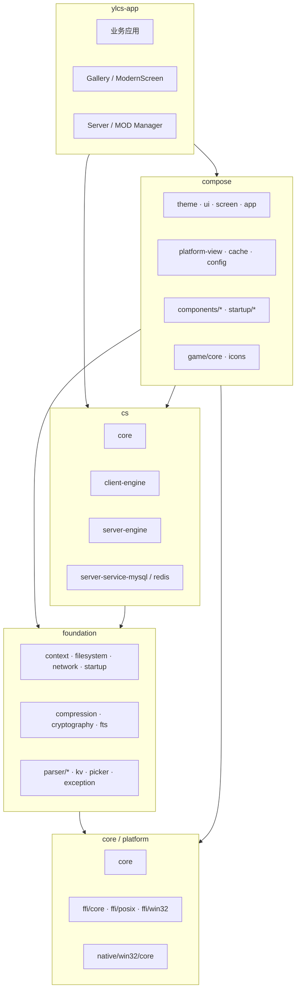

# 模块全景

<code>ylcs-module</code> 不是一个巨大的库，而是一组可独立引用的能力模块。它们的价值不在于数量，而在于依赖方向稳定、平台边界清晰、发布坐标可预测。

## 模块地图

依赖方向始终向下：业务应用依赖框架，框架不反向依赖业务；Compose 层依赖核心能力，核心能力不依赖 Compose。

## 模块分组

| 分组 | 模块 | 职责 |
| --- | --- | --- |
| 基础 | `core` | 平台、协程、序列化、URI、字节、依赖分析 |
| 基础能力 | `foundation/*` | 上下文、文件、网络、启动、压缩、加密、检索、解析 |
| Compose | `compose/core`、`theme`、`ui`、`screen`、`app` | 状态、视觉、组件、页面与应用入口 |
| 可选 UI | `compose/components/*` | 图片、媒体、日历、表格、WebView 等 |
| 通信 | `cs/*` | 契约、客户端引擎、原生服务端、MySQL/Redis |
| 平台 | `platform/ffi/*`、`platform/native/*` | FFI、动态库、POSIX、Win32 |
| 工具 | `build-tool`、`dokka`、`lint` | 测试聚合、API 文档、代码规范 |

## 发布坐标

模块路径按仓库约定映射为 Maven 坐标：

| 模块路径 | 组 | 工件 |
| --- | --- | --- |
| `ylcs-module/core` | `love.yinlin` | `core` |
| `ylcs-module/foundation/network` | `love.yinlin.foundation` | `network` |
| `ylcs-module/compose/theme` | `love.yinlin.compose` | `theme` |
| `ylcs-module/compose/components/image` | `love.yinlin.compose.components` | `image` |
| `ylcs-module/cs/client-engine` | `love.yinlin.cs` | `client-engine` |

坐标规则由 `namespace`、模块路径与 `stripFirstPathSegment` 共同决定。仓库内部开发优先使用 `projects.*`，不要依赖某个远端版本已经存在。

## 平台覆盖

不同模块的目标覆盖不同：

| 模块类型 | 常见目标 |
| --- | --- |
| `core`、`foundation/*` | 客户端全平台与桌面 Native |
| `compose/*` | Android、iOS、Desktop JVM、Web；部分含桌面 Native |
| `cs/core` | 客户端与服务端共享 |
| `cs/client-engine` | 客户端 |
| `cs/server-engine` | 桌面 Native 服务端 |
| `platform/ffi/*` | 原生与 JVM 的特定组合 |

平台声明不等于功能完整。组件可能有占位实现，服务端模块可能只启用 Native。以构建脚本、源集与运行验证为准。

## 阅读方式

| 你想了解 | 阅读 |
| --- | --- |
| 源集、依赖导出、API 边界 | [源集与 API](sourcesets.md) |
| 字节、压缩、加密、检索、解析器的深层约束 | [数据处理](data.md) |
| FFI、动态库、系统集成与资源所有权 | [平台与 FFI](platform.md) |
| 新增模块、测试、发布与维护 | [扩展与验证](extend.md) |

## 设计约束

1. **单向依赖。** 框架不依赖应用，核心不依赖 Compose。
2. **显式源集。** 继承关系由 DSL 声明，不依赖目录名。
3. **API 导出可控。** 公开类型需要的依赖必须导出。
4. **资源所有权明确。** 文件、流、原生句柄与监听器由明确所有者释放。
5. **平台差异可定位。** 平台 API 只出现在对应源集或最小 `expect/actual` 边界。

下一节从源集与 API 开始。
