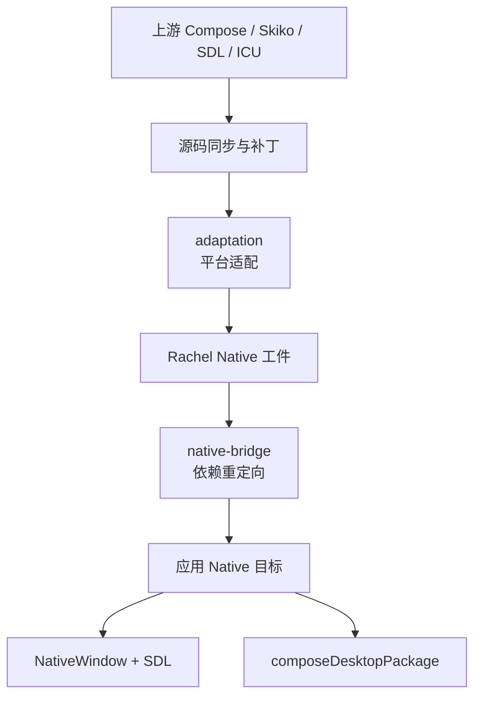

# 原生桌面

Native Compose 让同一套 Compose 界面直接运行在 Windows、Linux 与 macOS 的原生二进制中。它通过桥插件替换依赖、移植上游工件，并处理窗口、资源、ICU 与分发。

## 桥接层的职责

官方 Compose Multiplatform 的桌面目标主要面向 JVM。Native 目标需要：

1. 为 Compose、Skiko、Material3 等工件提供 Kotlin/Native 兼容版本；
2. 把官方依赖请求重定向到 Rachel 移植工件；
3. 提供原生窗口、事件循环、资源与文本后端；
4. 处理 ICU、Skia SDK、动态库与分发目录。

Rachel 将这些工作拆分为 `native-compose`（移植与适配）、`build-logic/native-bridge`（桥插件与窗口运行时）与 `native-binaries`（符号与二进制处理）。

## 目标范围

| 目标 | 说明 |
| --- | --- |
| Windows x64 | D3D12 / 软件渲染，MSVC 与 Windows SDK |
| Linux x64 | Vulkan / 软件渲染，桌面开发包与 Ninja |
| macOS arm64 | Metal，Xcode |

JVM、Android 与 Web 继续使用官方 Compose 工件，桥插件只在 Native target 生效。

## 设计边界

| 关注点 | 归属 |
| --- | --- |
| Compose API 与上游兼容 | `native-compose/adaptation`、上游锁 |
| 依赖替换与窗口 | `build-logic/native-bridge` |
| 资源、ICU、可执行程序 | 桥插件与模板 |
| 移植验证 | `native-compose/verification` |
| 应用业务 | `ylcs-app` 或你的应用模块 |

!!! note "移植维护与普通应用开发分离"
    应用开发者只需要安装桥插件、声明 Native 目标和 Compose 依赖，不需要检出或构建 Skia/SDL。移植维护者才需要同步上游源码、应用补丁并验证三个宿主。

## 本章结构

  <a class="rc-link-card" href="../bridge/">
    
6.1

    <h3>桥接与窗口</h3>
    
插件安装、目标开关、Compose 依赖、NativeWindow、拖动区与托盘。

    阅读桥接与窗口 →
  </a>
  <a class="rc-link-card" href="../distribution/">
    
6.2

    <h3>分发与维护</h3>
    
composeDesktopPackage、ICU、符号、验证任务与上游同步。

    阅读分发与维护 →
  </a>

## 适用场景

Native Compose 适合：

- 需要无 JVM 依赖的桌面应用；
- 需要更快启动、更小运行环境或原生窗口控制；
- 需要与 C/C++ 库、系统 API 或 SDL 能力直接集成；
- 需要在桌面端复用同一套 Compose 界面。

它不自动解决所有平台差异。窗口装饰、输入法、托盘、文件选择、媒体后端与系统集成仍需按平台验证。

## 下一步

从[桥接与窗口](bridge.md)开始配置第一个 Native 桌面应用。
