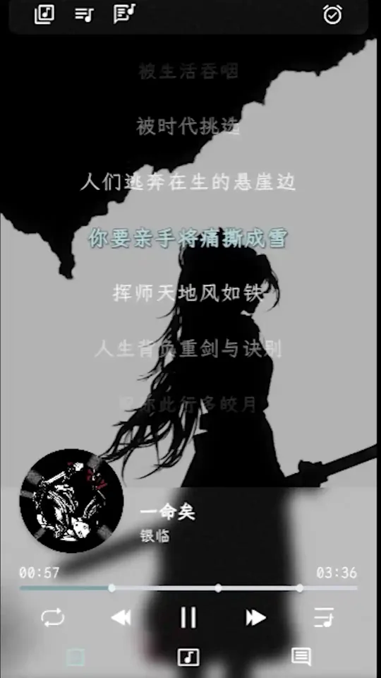
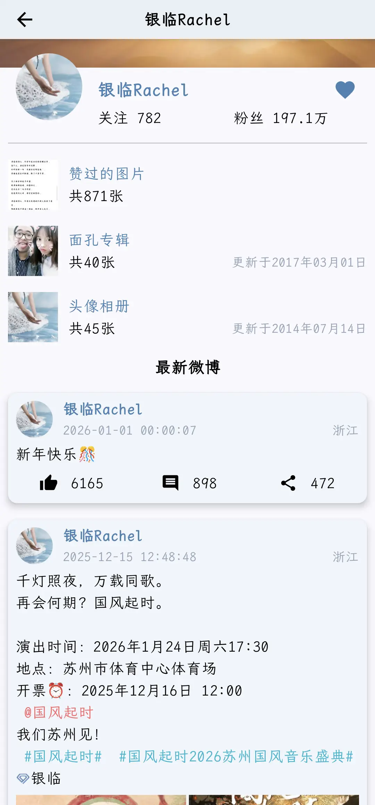
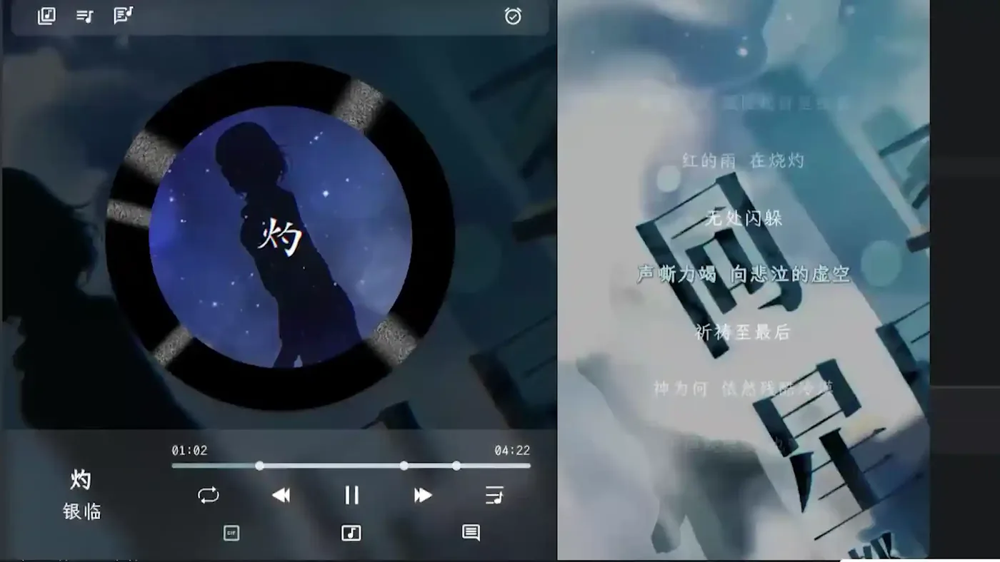
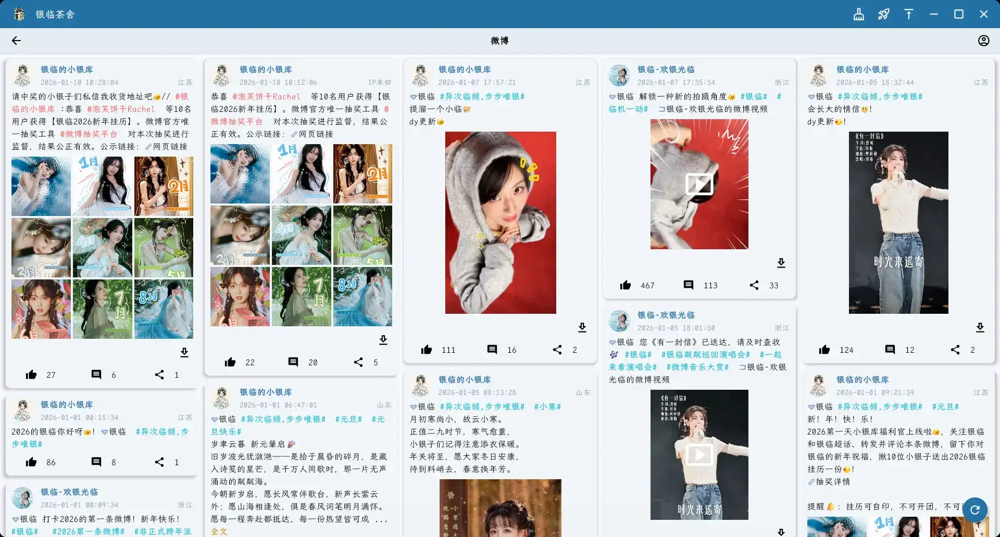
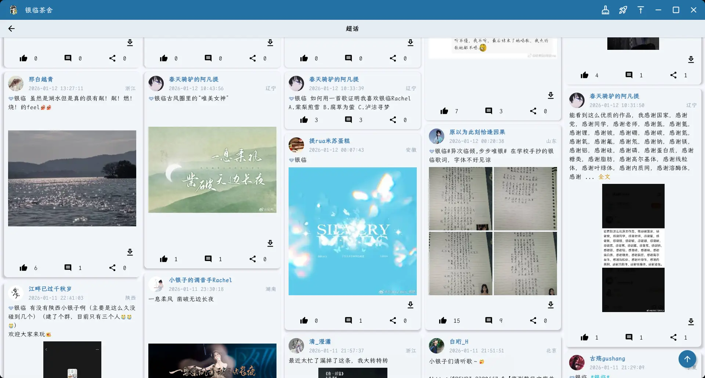
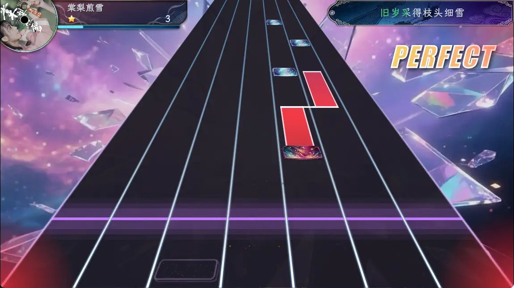
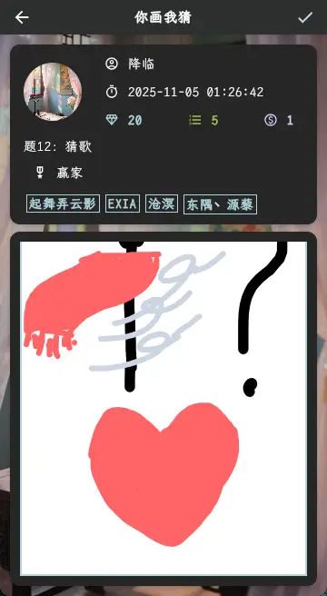
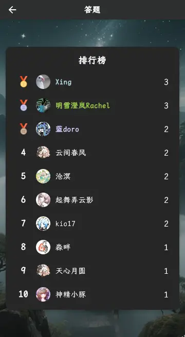
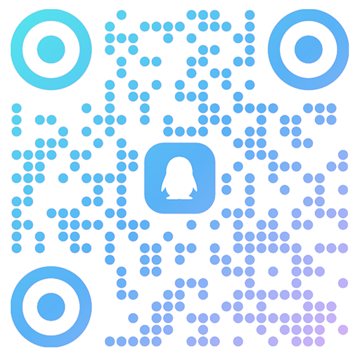

  

    
银临茶舍 · 跨平台应用

    <h1 class="rc-hero__title">把银临的世界 装进口袋</h1>
    
银临茶舍以资讯、音乐、美图、演出、社区与轻量游戏串联银临的作品与现场。同一套体验覆盖 Android、iOS、桌面与 Web，让每一次打开都回到熟悉的小银子聚集地。

    

      <a class="rc-btn rc-btn--primary" href="#download">下载最新版→</a>
      <a class="rc-btn" href="https://web.yinlin.love" target="_blank" rel="noopener">网页版↗</a>
      <a class="rc-btn" href="guide/">使用指南↗</a>
    

    

      v{{rachel_version}}
      Android
      iOS
      Windows
      Linux
      macOS
      Web
    

  

  

    

      

        
        <strong>银临茶舍</strong>YINLIN TEA HOUSE
      

      LINUX · MACOS · WINDOWS
      

        
      

      

        
      

      

        
      

    

  

  

    200+
    无损曲目与官方 MOD
  

  

    1000+
    4K 演出与活动美图
  

  

    8
    客户端与网页平台
  

  

    Open
    源码与框架持续开源
  

  

    

      
茶舍日常

      <h2 class="rc-section__title">一处在口袋里生长的茶舍</h2>
      
从最新资讯到无损音乐，从演出活动到主题社区，常用能力在同一个小银子聚集地中完成。

    

  

  

    

      
<svg viewBox="0 0 24 24" fill="none" stroke="currentColor" stroke-width="1.7" stroke-linecap="round" stroke-linejoin="round"><rect x="3" y="4" width="18" height="16" rx="3"/><path d="M7 8h10M7 12h6M7 16h8"/></svg>

      <h3>资讯与演出</h3>
      
实时同步微博、超话与抖音信息流，演出日历和活动条覆盖近六个月的现场消息，无需登录也能浏览。

      Information
    

    

      
<svg viewBox="0 0 24 24" fill="none" stroke="currentColor" stroke-width="1.7" stroke-linecap="round" stroke-linejoin="round"><path d="M9 18V5l10-2v13"/><circle cx="6" cy="18" r="3"/><circle cx="16" cy="16" r="3"/></svg>

      <h3>无损音乐</h3>
      
曲库收录 200 余首银临无损曲目，支持动态歌词、PV、伴奏、歌单与云备份，完整呈现每一首作品。

      Lossless Audio
    

    

      
<svg viewBox="0 0 24 24" fill="none" stroke="currentColor" stroke-width="1.7" stroke-linecap="round" stroke-linejoin="round"><rect x="3" y="4" width="18" height="16" rx="3"/><circle cx="8.5" cy="9" r="1.5"/><path d="m4 17 5-5 4 4 3-3 4 4"/></svg>

      <h3>4K 美图</h3>
      
收录演出官摄、海报与活动写真，图集以 4K 超清规格归档，也可以直接保存为壁纸。

      Gallery
    

    

      
<svg viewBox="0 0 24 24" fill="none" stroke="currentColor" stroke-width="1.7" stroke-linecap="round" stroke-linejoin="round"><path d="M21 12a8 8 0 0 1-8 8H6l-3 2 1-5a8 8 0 1 1 17-5Z"/><path d="M8 12h8M8 9h5"/></svg>

      <h3>主题社区</h3>
      
在发现页发表与银临有关的主题帖，围绕演出、作品与现场交流，保留属于小银子的公共讨论空间。

      Community
    

    

      
<svg viewBox="0 0 24 24" fill="none" stroke="currentColor" stroke-width="1.7" stroke-linecap="round" stroke-linejoin="round"><rect x="3" y="7" width="18" height="11" rx="4"/><path d="M8 12h3M9.5 10.5v3M16 11.5h.01M18 13.5h.01"/></svg>

      <h3>世界与游戏</h3>
      
歌词默写、在线对战与主题音游由小银子共同出题，配合排行榜与历史记录，在旋律中体验轻量竞技。

      World
    

    

      
<svg viewBox="0 0 24 24" fill="none" stroke="currentColor" stroke-width="1.7" stroke-linecap="round" stroke-linejoin="round"><circle cx="12" cy="8" r="4"/><path d="M4 21c.7-4 3.4-6 8-6s7.3 2 8 6"/></svg>

      <h3>个人空间</h3>
      
签到、银币、等级与名片构成长期陪伴的账号体系，邮箱接收活动提醒与节日祝福，资料与偏好由自己维护。

      Profile
    

  

  

    

      
音乐体验

      <h3>把无损曲库和动态歌词放在一起</h3>
      
银临茶舍提供完整的音乐播放器。歌曲、封面、歌词、动画、PV 与伴奏以 MOD 资源组织，播放、收藏与歌单管理在同一处完成。

      <ul class="app-showcase__list">
        <li>200 余首官方无损 MOD，支持逐行与逐字歌词</li>
        <li>歌单云备份、睡眠模式与多种循环策略</li>
        <li>动态壁纸、PV 视频与纯伴奏模式随资源解锁</li>
      </ul>
      

        <a class="rc-btn rc-btn--primary" href="guide/#music">音乐使用说明→</a>
      

    

    

      
Player / MOD<i></i><i></i><i></i>

      

        

        

      

    

  

  

    

      
Information / Gallery<i></i><i></i><i></i>

      

        <figure class="app-gallery__item app-gallery__item--wide">
          
          <figcaption>演出与资讯</figcaption>
        </figure>
        <figure class="app-gallery__item app-gallery__item--tall">
          
          <figcaption>活动详情</figcaption>
        </figure>
        <figure class="app-gallery__item app-gallery__item--low">
          
          <figcaption>4K 美图</figcaption>
        </figure>
      

    

    

      
资讯与影像

      <h3>消息与美图，都在同一条时间线上</h3>
      
资讯页汇集演出活动、微博、超话与抖音内容。活动详情会保留演出时间、城市与购票入口，美图页则把官摄与海报按高质量图集归档。

      <ul class="app-showcase__list">
        <li>演出日历与活动海报集中浏览</li>
        <li>微博、超话免登录阅读与更新追踪</li>
        <li>4K 图集下载，适合收藏与壁纸使用</li>
      </ul>
      

        <a class="rc-btn" href="guide/#information">资讯功能说明↗</a>
      

    

  

  

    

      
世界与社区

      <h3>和同好一起，把歌词写进游戏里</h3>
      
世界页收录与银临歌词相关的互动小游戏，对局由其他小银子提供。发现页则承接主题讨论、演出交流与日常分享，账号体系让参与留下记录。

      <ul class="app-showcase__list">
        <li>歌词默写、在线对战与测试期音游</li>
        <li>排行榜、历史记录与银币消耗规则</li>
        <li>主题帖、扫码名片与个人主页</li>
      </ul>
      

        <a class="rc-btn" href="guide/#world">世界与社区说明↗</a>
      

    

    

      
World / Identity<i></i><i></i><i></i>

      

        <figure class="app-world-stage__main">
          
        </figure>
        

          

            
            
          

        

      

    

  

  

    

      
获取应用

      <h2 class="rc-section__title">选择你的平台</h2>
      
当前版本 v{{rachel_version}}。手机端覆盖安装前请保留本地数据；桌面端解压后直接运行。

    

    <a class="rc-section__more" href="guide/">查看安装与更新说明 →</a>
  

  

    <article class="app-platform">
      
ANDStable

      <h3>Android</h3>
      
支持手机与平板，功能覆盖最完整，安装包约 10 MB，可直接安装。

      <a class="app-platform__action" href="https://yinlin.love/app/[Android]银临茶舍{{rachel_version}}.apk" download>下载 APK↓</a>
    </article>
    <article class="app-platform">
      
IOSAlpha

      <h3>iOS</h3>
      
支持 iPhone 与 iPad，需要通过自签侧载安装，部分能力仍在完善中。

      <a class="app-platform__action" href="https://yinlin.love/app/[iOS]银临茶舍{{rachel_version}}.ipa" download>下载 IPA↓</a>
    </article>
    <article class="app-platform">
      
WINStable

      <h3>Windows</h3>
      
功能覆盖与 Android 接近，支持桌面窗口操作，解压后即可使用。

      <a class="app-platform__action" href="https://yinlin.love/app/[Windows]银临茶舍{{rachel_version}}.zip" download>下载压缩包↓</a>
    </article>
    <article class="app-platform">
      
LNXBeta

      <h3>Linux</h3>
      
除音视频播放等依赖之外，整体体验与 Windows 桌面端基本一致。

      <a class="app-platform__action" href="https://yinlin.love/app/[Linux]银临茶舍{{rachel_version}}.zip" download>下载压缩包↓</a>
    </article>
    <article class="app-platform">
      
MACAlpha

      <h3>macOS</h3>
      
支持 Apple Silicon 与 Intel 桌面环境，部分媒体能力仍在适配。

      <a class="app-platform__action" href="https://yinlin.love/app/[macOS]银临茶舍{{rachel_version}}.zip" download>下载压缩包↓</a>
    </article>
    <article class="app-platform">
      
PWABeta

      <h3>PWA</h3>
      
可安装到桌面的网页应用，除本地文件存储相关能力外基本可用。

      <a class="app-platform__action" href="https://web.yinlin.love" target="_blank" rel="noopener">打开 PWA↗</a>
    </article>
    <article class="app-platform">
      
WEBAlpha

      <h3>Web</h3>
      
无需安装的网页版本，加载较快，性能表现会随浏览器而有所差异。

      <a class="app-platform__action" href="https://web.yinlin.love" target="_blank" rel="noopener">打开网页版↗</a>
    </article>
    <article class="app-platform">
      
SRVStable

      <h3>Server</h3>
      
服务端持续运行，源码和框架能力与客户端一同维护在开源仓库。

      <a class="app-platform__action app-platform__action--muted" href="https://github.com/rachel-ylcs/ylcs-kmp" target="_blank" rel="noopener">查看开源仓库↗</a>
    </article>
  

  

    

      
开源框架

      <h3>银临茶舍构建于 Rachel 之上</h3>
      
Rachel 以 Kotlin Multiplatform 与 Compose Multiplatform 组织共享核心、界面、导航、客户端与原生服务端。应用在各平台复用同一套业务与界面能力，同时保留平台入口和原生能力边界。

      

        <a class="rc-btn rc-btn--primary" href="https://rachel-ylcs.github.io/ylcs-kmp/">阅读 Rachel 文档→</a>
        <a class="rc-btn" href="https://github.com/rachel-ylcs/ylcs-kmp" target="_blank" rel="noopener">GitHub↗</a>
      

    

    

      
<strong>KMP</strong>共享核心与平台目标

      
<strong>CMP</strong>跨平台界面体系

      
<strong>Native</strong>原生桌面与服务端

      
<strong>MIT</strong>开源许可

    

  

  

    

      
加入茶舍

      <h3>为爱发电，也欢迎新的同路人</h3>
      
银临茶舍是免费、开源、非盈利的兴趣项目。无论是反馈问题、整理资料、参与开发还是加入日常交流，都可以从 QQ 水群和茶舍招新开始。

      <ul class="app-community__contacts">
        <li><a href="https://qm.qq.com/q/8sfRdA1XPy" target="_blank" rel="noopener">QQ 水群 ↗</a></li>
        <li><a href="https://weibo.com/u/7969517430" target="_blank" rel="noopener">微博 ↗</a></li>
        <li><a href="https://space.bilibili.com/3546773870086322" target="_blank" rel="noopener">哔哩哔哩 ↗</a></li>
        <li><a href="recruitment/">茶舍招新 →</a></li>
      </ul>
    

    

      
    

  

