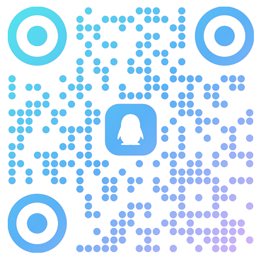

  

    
茶舍招新

    <h1>听凭风引，期待同路人</h1>
    
银临茶舍不是冷冰冰的工作室，而是由同好共同维护的兴趣小窝。我们因为对作品与现场的喜爱聚在一起，也欢迎愿意认真做事的伙伴加入。

  

  <h2>舍内小序</h2>
  
银临茶舍以 APP、社区与内容整理为载体，把银临的作品、演出与相关活动收拢到一处。项目免费、开源、非盈利，成员利用闲暇参与维护；比起头衔，我们更看重稳定、细致和对同好的尊重。

  <blockquote>
不求闻达于江湖，但求知音于此间。
</blockquote>
  <h2>招募方向</h2>
  

    <article class="app-role">
      
<h3>运营</h3>急招

      
负责平台日常内容发布与活动节奏维护，协同其他成员整理素材、安排发布计划。

      <strong>希望你能</strong>
      <small>具备视频剪辑能力，熟悉至少一个自媒体平台的发布与运营流程。</small>
    </article>
    <article class="app-role">
      
<h3>数据</h3>欢迎

      
负责资料整理、资源归档与信息校对，让演出、曲目与美图内容保持清晰可查。

      <strong>希望你能</strong>
      <small>有稳定的电脑使用条件与充足闲暇，做事耐心，愿意长期维护资料。</small>
    </article>
    <article class="app-role">
      
<h3>开发</h3>欢迎

      
参与 APP 维护、问题修复与功能开发，覆盖 Kotlin Multiplatform、Compose、Web 与服务端等方向。

      <strong>希望你能</strong>
      <small>具备 Android、Kotlin、Java、Web 或原生开发经验之一，能够阅读现有工程并遵循项目约定。</small>
    </article>
    <article class="app-role">
      
<h3>宣发</h3>活跃

      
在 B 站、小红书等平台策划内容与活动，让更多同好了解茶舍、听见茶舍的声音。

      <strong>希望你能</strong>
      <small>熟悉自媒体内容节奏，性格外向，能够捕捉流行风向并保持稳定输出。</small>
    </article>
  

  <h2>参与方式</h2>
  

    <h2>从一次交流开始</h2>
    

      

        
加入 QQ 水群即可了解当前项目状态与招募进度。说明希望参与的方向、可投入的时间和过往作品，我们会根据实际需要安排后续沟通。

        <ul>
          <li>邮箱：1595810301@qq.com</li>
          <li>B 站 / 微博：银临茶舍</li>
          <li>QQ 群：828049503</li>
        </ul>
      

      

        
      

    

    

      <a class="rc-btn rc-btn--primary" href="https://qm.qq.com/q/8sfRdA1XPy" target="_blank" rel="noopener">加入 QQ 水群↗</a>
      <a class="rc-btn" href="index.md">返回官网首页→</a>
    

  

